# VERIDEX — Architecture

## High-Level Architecture

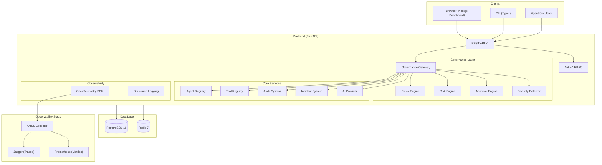

## Agent Execution Lifecycle

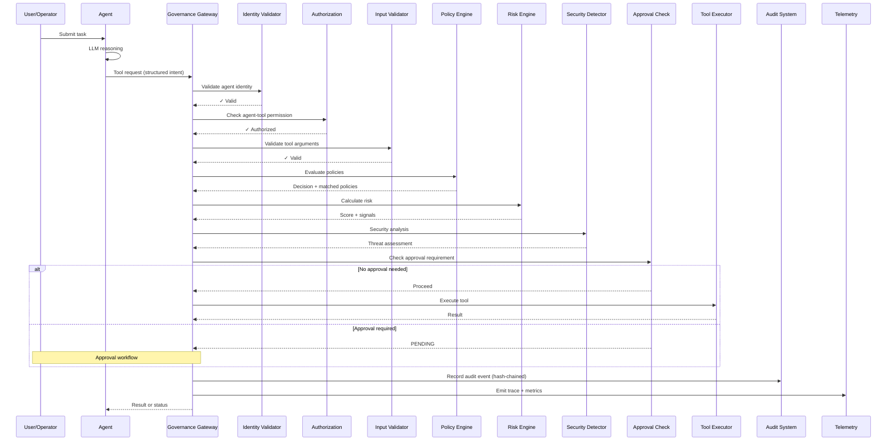

## Governance Gateway Pipeline

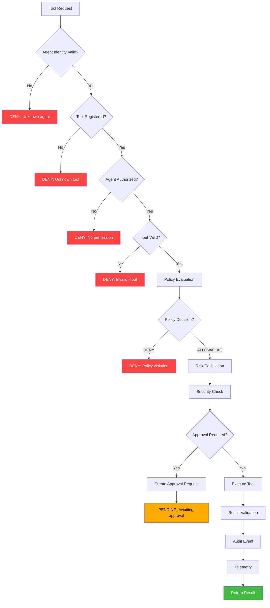

## Agent to Tool Architecture

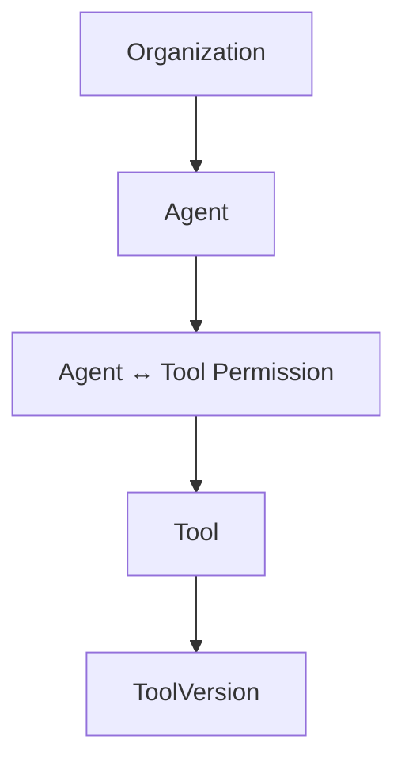


## Database ERD (Core)

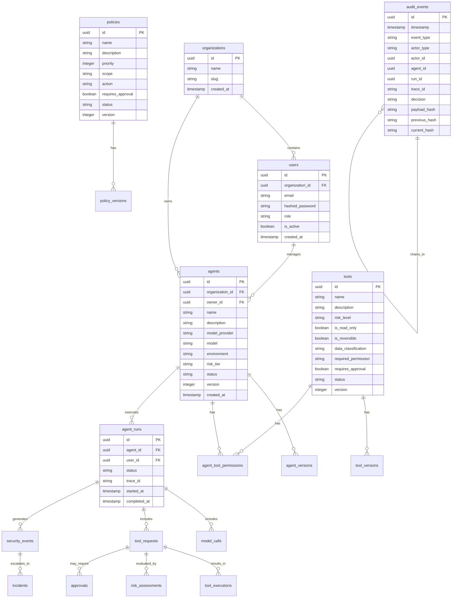

## Audit Hash Chain

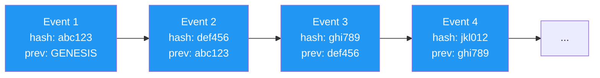

Each event: `current_hash = SHA256(event_data + previous_hash)`

Tampering with any event breaks the chain for all subsequent events.

## Trust Boundaries

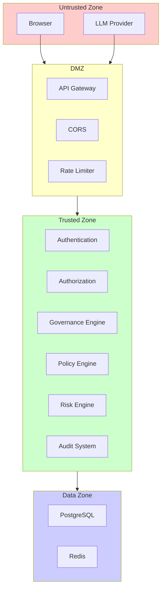

## Service Boundaries

| Service | Responsibility | Dependencies |
|---------|---------------|-------------|
| **API** | HTTP routing, request validation | Auth, all features |
| **Auth** | Authentication, token management | Database |
| **Agent Registry** | Agent CRUD, versioning | Database, Auth |
| **Tool Registry** | Tool CRUD, permissions | Database, Auth |
| **Governance Gateway** | Central control point | Policy, Risk, Approval, Security, Audit |
| **Policy Engine** | Deterministic policy evaluation | Database |
| **Risk Engine** | Risk score calculation | Database |
| **Approval Engine** | Human approval workflow | Database, Redis |
| **Audit System** | Tamper-evident event logging | Database |
| **Security Detector** | Threat detection | Database |
| **Incident System** | Security incident management | Database, Security Detector |
| **AI Provider** | LLM abstraction | External API / Mock |
| **Telemetry** | Tracing, metrics, logging | OTEL Collector |

## Data Flow

```
HTTP Request
  → CORS validation
  → Authentication (JWT)
  → Authorization (RBAC)
  → Request validation (Pydantic)
  → Business logic
  → Database operations (SQLAlchemy async)
  → Response serialization
  → Structured logging
  → Telemetry export
```

## Governance Gateway Architecture (Phase 5)

The Governance Gateway serves as the single deterministic mediation layer through which every agent tool invocation must pass before execution.

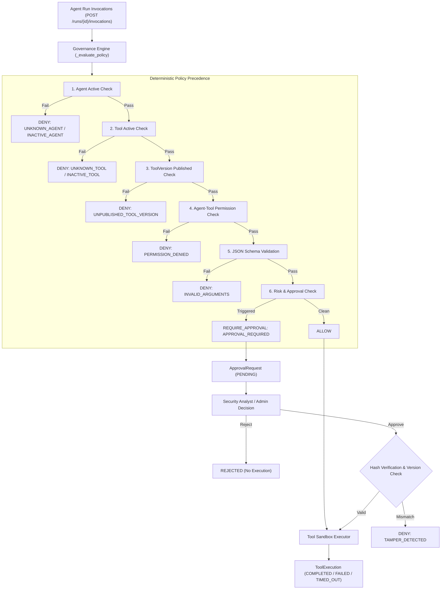

### Governance Data Model Relationships

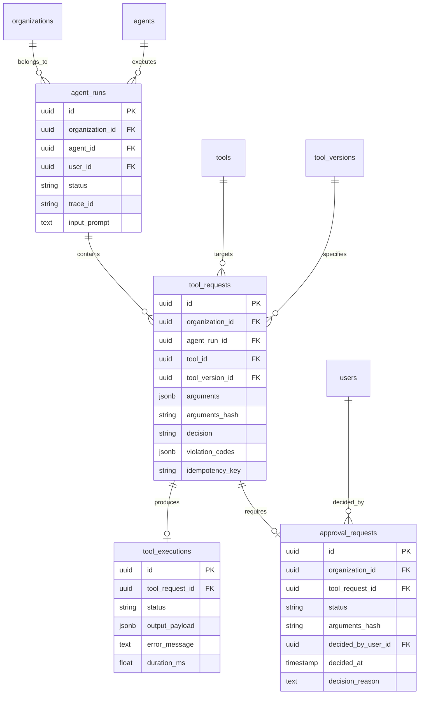

### Execution Sandbox & Isolation Layer

- **Closed Handler Registry:** Execution is dispatched strictly to pre-registered, verified handlers (`calculator`, `echo`, `system-status`, `data-lookup`).
- **No Arbitrary Code:** Arbitrary user strings, Python `eval`/`exec`, or shell invocations are completely rejected.
- **Timeout Isolation:** Asynchronous calls are wrapped in `asyncio.wait_for` with tool-specific timeout thresholds. If exceeded, executions are immediately terminated and persisted with status `TIMED_OUT`.
- **Integrity Verification:** Arguments and tool version IDs are hashed with SHA-256 over canonical JSON. Approvals verify this hash prior to executing the tool, preventing state manipulation.

## Policy Engine Architecture (Phase 6)

The Policy Engine delivers deterministic, declarative, multi-tier rule evaluation for all agent tool requests, executing between baseline platform safety checks and runtime execution.

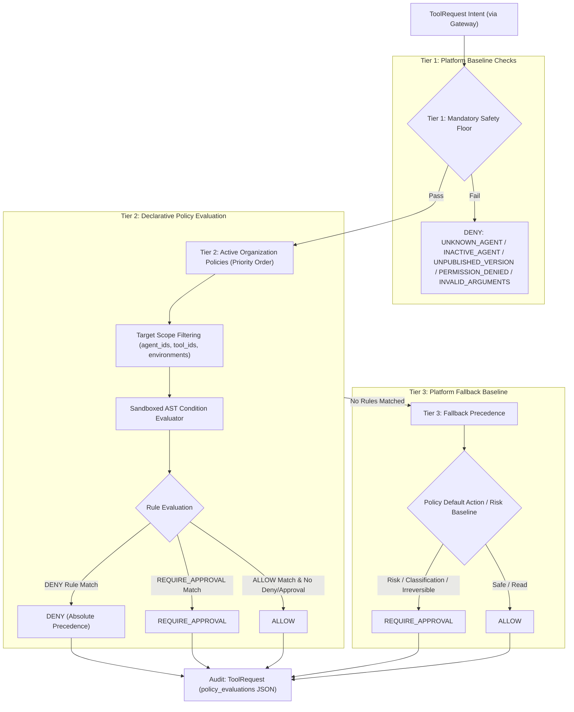

### Policy Engine Domain Model

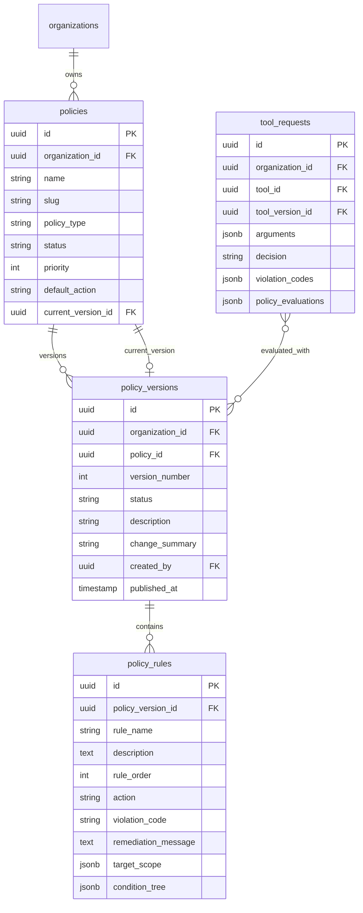

### Policy & Version Lifecycle State Machines

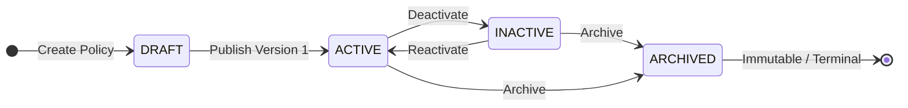

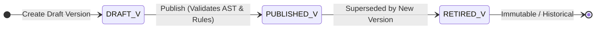

### AST Condition Evaluator Specification

- **Sandboxing:** Dynamic execution functions (`eval`, `exec`, `compile`, `getattr`) are prohibited.
- **Traversal:** Dotted path resolution (`arguments.amount`, `agent.environment`, `tool.name`, `context.risk_level`).
- **Complexity Envelopes:**
  - Max AST tree depth: 5
  - Max condition clauses: 20
  - Max payload size: 64 KB
  - Max string comparison length: 1,024 characters
- **ReDoS Immunity (Google RE2):**
  - Linear-time automata engine (`google-re2`) guaranteeing mathematical $O(n)$ time complexity in input length.
  - Catastrophic backtracking is fundamentally eliminated without relying on worker threads, timeouts, or task queues.
  - Regex pattern length capped at 128 characters, target input string capped at 1,024 characters.
  - Static authoring-time rejection of nested quantifiers, quantified alternations, and non-linear backreferences.

---

## Phase 7 — Risk Engine & 5-Stage Precedence Architecture

The Risk Engine provides deterministic quantitative risk scoring, empirical agent trust tracking, dynamic argument heuristic inspection, and immutable versioned risk configurations.

### 5-Stage Decision Precedence Pipeline

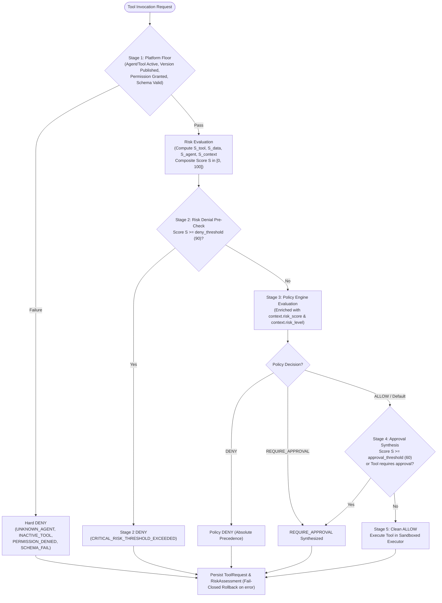

### Risk Engine Domain Model (ERD)

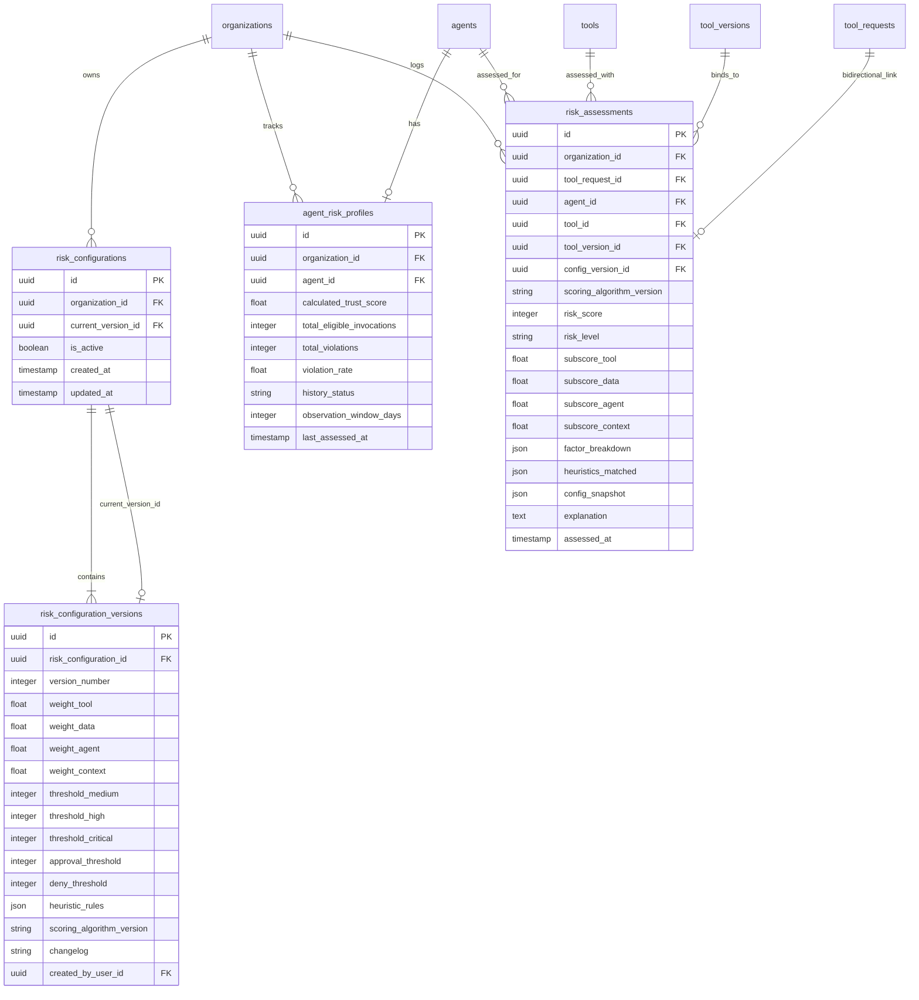

### Four-Vector Quantitative Scoring Specification

1. **Tool Blast Radius Subscore ($S_{\text{tool}}$):**
   $$S_{\text{tool}} = 0.40 \cdot \text{tier\_pts} + 0.30 \cdot \text{access\_pts} + 0.30 \cdot \text{reversibility\_pts}$$
   - Risk Tier: `LOW`: 0.0, `MEDIUM`: 25.0, `HIGH`: 60.0, `CRITICAL`: 100.0.
   - Access Type: `READ`: 0.0, `WRITE`: 50.0.
   - Reversibility: `REVERSIBLE`: 0.0, `IRREVERSIBLE`: 100.0.

2. **Data Classification & Impact Subscore ($S_{\text{data}}$):**
   $$S_{\text{data}} = 0.70 \cdot \text{classification\_pts} + 0.30 \cdot \text{approval\_pts}$$
   - Data Classification: `PUBLIC`: 0.0, `INTERNAL`: 25.0, `CONFIDENTIAL`: 60.0, `RESTRICTED`: 100.0.
   - Approval Requirement: `NOT_REQUIRED`: 0.0, `OPTIONAL`: 50.0, `REQUIRED`: 100.0.

3. **Agent Trust & Violation History Subscore ($S_{\text{agent}}$):**
   $$S_{\text{agent}} = \min(100.0, \text{tier\_pts} + \text{violation\_penalty})$$
   - Risk Tier: `LOW`: 0.0, `MEDIUM`: 25.0, `HIGH`: 60.0, `CRITICAL`: 100.0.
   - 7-day observation window, up to 50 samples.
   - When sample size $N < 5$: status is `INSUFFICIENT_DATA`, violation rate defaults to 0.0, and conservative baseline trust score (100.0) is applied.
   - When $N \ge 5$: status is `VALID`, $\text{violation\_rate} = \text{violations} / N$, and violation penalty applies linearly.

4. **Runtime Context Risk Subscore ($S_{\text{context}}$):**
   $$S_{\text{context}} = \min(100.0, \text{env\_pts} + \sum \text{heuristic\_pts})$$
   - Environment: `DEVELOPMENT`: 0.0, `STAGING`: 25.0, `PRODUCTION`: 60.0.
   - Argument Heuristics: Pattern matches for destructive commands (`rm -rf`, `DROP TABLE`), SQL injections, wildcard scopes (`*`), and large financial thresholds.

5. **Composite Score & Classification:**
   $$S_{\text{composite}} = \text{round}(w_{\text{tool}} S_{\text{tool}} + w_{\text{data}} S_{\text{data}} + w_{\text{agent}} S_{\text{agent}} + w_{\text{context}} S_{\text{context}})$$
   - Classification: `LOW` (0–29), `MEDIUM` (30–59), `HIGH` (60–84), `CRITICAL` (85–100).
   - Enforces default thresholds: `approval_threshold = 60`, `deny_threshold = 90`.

## Phase 8 — Monitoring, Observability & Governance Analytics

### Phase 8.1 — OpenTelemetry Instrumentation & Operational Tracing Foundation

Phase 8.1 establishes the foundational distributed tracing and metrics infrastructure across the Veridex platform.

#### 1. Centralized Telemetry Setup & Architecture

OpenTelemetry initialization is centralized in `backend/app/telemetry/setup.py`, providing idempotent lifecycle management and fail-safe operation:

- **Resource Configuration:**
  - `service.name`: Configured via `VERIDEX_OTEL_SERVICE_NAME` (default: `veridex-backend`).
  - `service.version`: Configured via `settings.app_version` (e.g. `0.1.0`).
  - `deployment.environment`: Configured via `settings.environment` (`development`, `staging`, `production`).
- **TracerProvider & BatchSpanProcessor:**
  - Production `BatchSpanProcessor` configured with strict non-blocking bounds:
    - Queue Capacity: 2048 spans.
    - Max Export Batch: 512 spans.
    - Schedule Delay: 5000 ms.
    - Export Timeout: 3000 ms.
  - Exporter: `OTLPSpanExporter` connecting to `VERIDEX_OTEL_EXPORTER_ENDPOINT` (default: `http://localhost:4317`) over gRPC with a 3.0s timeout.
- **MeterProvider & Metric Readers:**
  - `PeriodicExportingMetricReader` with 10,000ms collection interval and 3,000ms export timeout.
  - Exporter: `OTLPMetricExporter` over gRPC with a 3.0s timeout.
- **Auto-Instrumentation:**
  - **FastAPI:** Auto-instrumented via `FastAPIInstrumentor.instrument_app`, with `excluded_urls="health,ready"` ensuring high-frequency liveness/readiness probes do not generate traces.
  - **SQLAlchemy:** Auto-instrumented via `SQLAlchemyInstrumentor().instrument(engine=sync_engine, enable_commenter=False)` on the synchronous engine. Parameter values and comments are excluded to prevent SQL data leakage.
  - **HTTPX:** Auto-instrumented via `HTTPXClientInstrumentor().instrument()` for outbound client requests.

#### 2. Governance Gateway Tracing & Span Hierarchy

Every tool invocation through `GovernanceService.invoke_tool()` is traced hierarchically:

- **Parent Span (`veridex.governance.evaluate`):**
  - Measures the end-to-end governance policy evaluation duration.
  - Records safe operational attributes:
    - `veridex.organization_id`: Organization UUID.
    - `veridex.run_id`: AgentRun UUID.
    - `veridex.agent_id`: Agent UUID.
    - `veridex.tool_id`: Tool UUID.
    - `veridex.tool_version_id`: ToolVersion UUID.
    - `veridex.decision`: Evaluated governance outcome (`ALLOW`, `DENY`, `REQUIRE_APPROVAL`).
    - `veridex.violation_codes`: List of machine-readable violation codes.
    - `veridex.risk_score`: Deterministic integer risk score (0–100).
    - `veridex.risk_level`: Evaluated risk classification tier.
    - `veridex.operation`: Bounded operation category (`read`, `write`, `execute`).
  - Strict privacy exclusions: `arguments_hash`, `idempotency_key`, and raw payload arguments are strictly forbidden and excluded.
- **Child Span (`veridex.tool.execute`):**
  - Generated exclusively when a tool execution is dispatched via `ToolExecutor.execute()` (on `ALLOW` or post-approval execution).
  - Nested directly under `veridex.governance.evaluate`.
  - Records execution outcome and latency:
    - `veridex.tool_id`: Target tool UUID.
    - `veridex.operation`: Bounded operation category (`read`, `write`, `execute`).
    - `veridex.status`: Execution status (`SUCCESS`, `FAILED`, `TIMED_OUT`).
    - `veridex.duration_ms`: Execution duration in milliseconds.

#### 3. Bounded Low-Cardinality Operational Metrics

Four core metrics instruments track platform throughput and latency without risk of dimensional explosion:

| Metric Name | Instrument | Unit | Bounded Dimensions | Description |
|---|---|---|---|---|
| `veridex.governance.requests` | Counter | `1` | `decision`, `risk_level`, `environment` | Count of governance evaluation requests. |
| `veridex.governance.evaluation.duration` | Histogram | `s` | `decision`, `risk_level`, `environment` | Latency distribution of policy evaluations. |
| `veridex.tool.executions` | Counter | `1` | `operation`, `status`, `environment` | Count of tool executions executed by gateway. |
| `veridex.tool.execution.duration` | Histogram | `s` | `operation`, `status`, `environment` | Latency distribution of tool executions. |

*Cardinality Control:* The `operation` dimension is strictly normalized to a finite bounded category (`read`, `write`, `execute`, `custom`, `unknown`). Arbitrary organization-defined tool slugs are never used as metric labels.

#### 4. Trace Privacy, Sanitization & Failure Isolation

- **Zero Payload Leakage:** Raw tool arguments (`request.arguments`), execution results (`execution.result`), input prompts, output summaries, session tokens, cookies, and unkeyed argument hashes are strictly excluded from spans and metric dimensions.
- **Fail-Silent Telemetry:** All span attribute updates and metric recordings are wrapped in safe helper methods (`safe_set_attributes`, `record_governance_request`, `record_tool_execution`). Telemetry exceptions are logged at `DEBUG` level and never alter, delay, or block governance decision outcomes.
- **Clean Lifespan Integration:** Application startup initializes telemetry through `FastAPI` lifespan; application shutdown flushes exporters within a 5-second graceful window to prevent zombie processes.

---

### Phase 8.2 — Governance Evaluation Performance Monitoring & Database Optimization

Phase 8.2 introduces persistent, high-resolution governance latency tracking and optimized composite database indexes for scalable governance analytics.

#### 1. Evaluation Latency Measurement & Persistence

To monitor governance overhead accurately, `ToolRequest` records the precise latency of policy and risk evaluation:

- **Model Field:** `ToolRequest.evaluation_duration_ms: Mapped[float | None]`
  - Stored as `Float` with sub-millisecond precision.
  - Nullable (`None`) for historical requests created prior to Phase 8.2 or requests that fail prior to policy evaluation.
  - Enforces non-negative validation via `@validates("evaluation_duration_ms")`: rejects values `< 0.0`.
- **Timing Boundary:**
  - High-resolution monotonic timer: `time.perf_counter_ns()`.
  - Timer starts immediately before `GovernanceService._evaluate_policy()` and stops immediately upon its completion using a strict `try/finally` block.
  - **Included in duration:** Mandatory rule checks, risk engine scoring, dynamic policy evaluation, and internal database reads required during evaluation.
  - **Excluded from duration:** Pre-evaluation argument hashing and tool request initialization, tool execution runtime, OpenTelemetry tracing and metric dispatch, and database persistence (`session.commit()` / audit logging).
  - **Measured across all decision outcomes:** `ALLOW`, mandatory rule `DENY`, risk engine `DENY`, policy rule `DENY`, `REQUIRE_APPROVAL`, and risk persistence failures.
- **Distinction from Tool Execution Duration:**
  - `evaluation_duration_ms` measures the internal overhead of the VERIDEX governance decision pipeline.
  - `tool_execution.duration_ms` measures the execution latency of the downstream tool itself (dispatched only when decision is `ALLOW` or post-approval).

#### 2. Composite Database Index Strategy

To support high-throughput governance analytics and tenant-isolated aggregations across millions of audit records, six composite indexes are added:

| Index Name | Table | Columns | Ordering & Rationale |
|---|---|---|---|
| `ix_tool_requests_org_evaluated` | `tool_requests` | `(organization_id, evaluated_at)` | Accelerates general time-range queries and volumetric aggregations per organization. |
| `ix_tool_requests_org_decision_evaluated` | `tool_requests` | `(organization_id, decision, evaluated_at)` | Optimizes filtered analytics by decision status (`ALLOW`, `DENY`, `REQUIRE_APPROVAL`) over time windows. |
| `ix_tool_requests_org_agent_evaluated` | `tool_requests` | `(organization_id, agent_id, evaluated_at)` | Accelerates per-agent activity, performance, and risk trend analysis across time ranges. |
| `ix_tool_requests_org_tool_evaluated` | `tool_requests` | `(organization_id, tool_id, evaluated_at)` | Optimizes per-tool invocation frequency and latency aggregations across time windows. |
| `ix_risk_assessments_org_assessed` | `risk_assessments` | `(organization_id, assessed_at)` | Accelerates historical risk assessment retrieval and score distribution aggregations. |
| `ix_approval_requests_org_created` | `approval_requests` | `(organization_id, created_at)` | Accelerates pending and historical approval queue inspection and resolution time queries. |

- **Leading `organization_id`:** Every composite index enforces tenant isolation at the leading column, ensuring B-tree traversals are strictly bound to the requesting tenant's partition.
- **Trailing Timestamp (`evaluated_at`, `assessed_at`, `created_at`):** Supports index range scans and descending order sorts for time-windowed analytics queries.

#### 3. Migration Architecture

- **Alembic Revision:** `e59b2f6a9c40` (`add_eval_duration_and_governance_indexes`)
- **Downstream of:** `d48a1e5f8b30` (Phase 7.1 risk engine revision)
- **Reversibility:** Fully bidirectional with tested `upgrade()` and `downgrade()` functions producing safe transactional DDL.

---

### Phase 8.3 — Governance Analytics Engine & Read-Only Anomaly Detection

Phase 8.3 introduces a dedicated, organization-isolated service layer for governance analytics, historical aggregations, latency percentiles, and read-only anomaly detection.

> [!NOTE]
> Phase 8.3 implements the internal Python service and query aggregation layer only (`backend/app/analytics/`). Analytics REST endpoints, routing, and HTTP access control will be implemented in Phase 8.4.

#### 1. Analytics Service Architecture

The analytics domain is structured in `backend/app/analytics/` adhering to single-responsibility separation:

- **`service.py` (`AnalyticsService`):**
  - High-level coordinator enforcing tenant boundaries, time-window normalization, and pagination.
  - Pure read-only operation: performs zero database mutations (`INSERT`, `UPDATE`, `DELETE`) or state changes.
- **`queries.py` (`AnalyticsQueries`):**
  - Database-side SQL aggregations using SQLAlchemy 2.0 Core expressions.
  - Avoids unbounded ORM model materialization by executing grouped aggregations in SQL.
- **`schemas.py`:**
  - Pydantic v2 schemas providing strict type safety, UTC-aware datetime parsing, and bounded pagination metadata.
- **`anomalies.py` (`AnomalyDetector`):**
  - Evaluates deterministic, read-only statistical anomaly detection rules across sliding time windows.
  - Does not emit alerts, dispatch webhooks, or trigger background jobs.
- **`exceptions.py`:**
  - Domain exceptions: `InvalidTimeRangeError`, `InvalidGranularityError`, `InvalidPaginationError`, and `TenantIsolationError`.

#### 2. Global Time Semantics & Organization Isolation

- **Timezone & Window Boundaries:**
  - All timestamps are normalized and handled strictly in UTC.
  - Intervals are evaluated as half-open ranges: `[start_time, end_time)` (`timestamp >= start_time AND timestamp < end_time`).
  - Default time window: trailing 7 days (`end_time = datetime.now(UTC)`, `start_time = end_time - 7 days`).
  - Maximum supported time window: 90 days. Queries exceeding 90 days are rejected with `InvalidTimeRangeError`.
  - Rejection of inverted intervals: `start_time >= end_time` raises `InvalidTimeRangeError`.
- **Multi-Tenant Isolation Guarantees:**
  - Every query enforces `organization_id` as a mandatory, non-optional filter parameter provided by authenticated application context.
  - Cross-tenant data, identifiers, or counts are strictly excluded from aggregates.
  - `ToolExecution` records lack an `organization_id` column; all tool execution aggregations perform an `INNER JOIN` to `ToolRequest` and filter on `ToolRequest.organization_id`.
  - Empty tenant datasets return zeroed counters and structured empty responses without division or null-pointer errors.

#### 3. Core Metric Definitions

- **Overview Analytics:**
  - `total_invocations`: Count of persisted `ToolRequest` records in interval.
  - Decision counts and percentages: `ALLOW`, `DENY`, and `REQUIRE_APPROVAL`.
  - Total tool executions: Count of `ToolExecution` records joined through `ToolRequest`.
  - Approvals breakdown: Total, `APPROVED`, `REJECTED`, `PENDING`, and `EXPIRED`.
  - `approval_resolution_rate`: Defined as `approved / (approved + rejected)`. Evaluates to `None` (null) when the denominator is zero. Pending and expired approval requests are excluded from the resolution rate denominator.
- **Agent Analytics & Historical Denial Rate:**
  - `historical_denial_rate`: Defined strictly as `DENY decisions / total invocations in interval`.
  - *Distinction from Violation Rate:* `historical_denial_rate` reflects policy and security denials, which are standard security controls and do NOT constitute proof of agent misconduct. Empirical violations and sliding-window violation rates are tracked independently in `AgentRiskProfile.violation_rate`.
- **Tool Utilization & Execution Disconnect:**
  - `ToolExecution` status breakdown: `SUCCESS`, `FAILED`, and `TIMED_OUT`.
  - *Execution vs. Governance Disconnect:* A governance `ALLOW` outcome authorizes execution but does not guarantee downstream tool success; tools may crash or time out. Analytics explicitly tracks execution outcomes independently of governance decisions.
- **Latency Analytics:**
  - `evaluation_latency`: Pure internal latency of the VERIDEX policy decision engine from `ToolRequest.evaluation_duration_ms` (excluding nulls).
  - `execution_latency`: Downstream tool execution duration from `ToolExecution.duration_ms`.
  - Statistics calculated: `avg`, `min`, `max`, `p50`, `p95`, `p99`.

#### 4. Percentile Calculation Architecture

- **PostgreSQL Production Implementation:**
  - Utilizes native `percentile_cont(0.50 | 0.95 | 0.99) WITHIN GROUP (ORDER BY column)` executed entirely within the database engine.
- **SQLite Test Compatibility Fallback:**
  - Because SQLite lacks native percentile aggregate functions, tests utilize an isolated fallback:
    - Queries summary stats (`min`, `max`, `avg`, `count`) in SQL.
    - If `count > 0`, retrieves sorted latency values with a strict boundary (`LIMIT 10000`) and computes percentiles using linear interpolation in Python.
    - Preserves test reproducibility while preventing unbounded memory consumption.

#### 5. Read-Only Anomaly Detection Rules

The `AnomalyDetector` evaluates three statistical rules against current and baseline windows:
- **Current Window:** `[T - 1 hour, T)`
- **Baseline Window:** `[T - 7 days, T - 1 hour)`

| Rule | Trigger Condition | Effective Baseline Floor | Minimum Sample Floor | Severity |
|---|---|---|---|---|
| **Rule A: Denial-Rate Spike** | Current Denial Rate $\ge 20\%$ **AND** Current $\ge 2.5 \times$ Effective Baseline | If baseline denial rate is $0\%$, effective baseline is floored at $5\%$ ($0.05$) | Current $\ge 20$ requests, Baseline $\ge 100$ requests | `HIGH` |
| **Rule B: Critical Risk Surge** | Current Critical Risk Rate $\ge 15\%$ | N/A | Current $\ge 20$ risk assessments | `CRITICAL` |
| **Rule C: Latency SLA Degradation** | Current p95 $\ge 50$ ms **AND** Current p95 $\ge 3 \times$ Baseline p95 | N/A | Current $\ge 20$ latency samples, Baseline $\ge 100$ samples | `HIGH` |

- **Sample Size Safeguards:** If sample size requirements are not satisfied, the detector returns an explicit `INSUFFICIENT_DATA` status along with actual observed counts, preventing false-positive alerts on low-traffic intervals.

---

### Phase 8.4 — Analytics REST APIs, Authentication & Role-Based Access Control

Phase 8.4 exposes the Phase 8.3 Analytics Service through authenticated, organization-isolated REST endpoints.

#### 1. Router Architecture & Canonical Endpoints

The API router is located at `backend/app/api/v1/analytics.py` and mounted under `/api/v1/analytics` in the primary API v1 router:

| Endpoint | Method | Response Model | Description |
|---|---|---|---|
| `/api/v1/analytics/overview` | `GET` | `OverviewAnalytics` | Aggregate invocation totals, decision rates, and approval resolution statistics. |
| `/api/v1/analytics/trends` | `GET` | `TrendsAnalytics` | Time-series buckets (`hour` or `day`) with zero-filled intervals. |
| `/api/v1/analytics/risk-distribution` | `GET` | `RiskDistributionAnalytics` | Quantitative risk summary metrics and standard 10-bucket risk histogram. |
| `/api/v1/analytics/agents` | `GET` | `AgentAnalyticsResponse` | Paginated per-agent activity, historical denial rates, and trust profiles. |
| `/api/v1/analytics/tools` | `GET` | `ToolUtilizationResponse` | Paginated per-tool invocation frequency, execution success rates, and latencies. |
| `/api/v1/analytics/anomalies` | `GET` | `AnomalyReport` | Read-only statistical anomaly evaluation across current and baseline windows. |

#### 2. Strict Role-Based Access Control (RBAC)

Access to the analytics router is restricted to governance and security oversight roles:

| Role | Result | Access Policy |
|---|---|---|
| `ADMIN` | **Allowed (200)** | Full administrative visibility across organizational analytics. |
| `SECURITY_ANALYST` | **Allowed (200)** | Operational oversight, trend inspection, and anomaly investigation. |
| `AUDITOR` | **Allowed (200)** | Compliance review and historical reporting access. |
| `AGENT_OPERATOR` | **Forbidden (403)** | Operator roles are restricted to agent execution and tool invocation. |
| `VIEWER` | **Forbidden (403)** | Read-only viewer role lacks governance reporting privileges. |
| *Unauthenticated* | **Unauthorized (401)** | Missing or invalid Bearer JWT token. |

Enforced using FastAPI dependency injection via `RequireRole([Role.ADMIN, Role.SECURITY_ANALYST, Role.AUDITOR])`.

#### 3. Strict Multi-Tenant Isolation

- **Authoritative Tenant Principal:** The calling tenant's `organization_id` is derived exclusively from the authenticated JWT token (`current_user.organization_id`).
- **Query Parameter Tampering Defense:** Any attempt by a caller to pass a `?organization_id=...` query parameter is proactively intercepted and rejected with `400 Bad Request`.
- **Zero Cross-Tenant Leakage:** All underlying queries are strictly parameterized by the caller's organization UUID. Tool executions are joined through `ToolRequest` to maintain tenant boundary guarantees.

#### 4. Thin Handler Pattern & Error Mapping

- **Zero Duplication:** Endpoint handlers act strictly as thin controllers, delegating all query construction and business logic to `AnalyticsService`.
- **Exception Mapping:**
  - `InvalidTimeRangeError` $\rightarrow$ `422 Unprocessable Entity`
  - `InvalidGranularityError` $\rightarrow$ `422 Unprocessable Entity`
  - `InvalidPaginationError` $\rightarrow$ `422 Unprocessable Entity`
  - Missing credentials $\rightarrow$ `401 Unauthorized`
  - Insufficient role $\rightarrow$ `403 Forbidden`
  - Unexpected internal errors $\rightarrow$ `500 Internal Server Error` (internal stack traces and DB details suppressed)

---

### Phase 8.5 — Final Integration, Quality Assurance & Release Readiness

Phase 8.5 consolidates all four Phase 8 sub-phases into a cohesive, production-grade observability and governance analytics subsystem.

#### 1. End-to-End Governance Observability Lifecycle

```
[Agent Tool Request]
         │
         ▼
[Governance Gateway (eval_start_ns)]
   ├── Stage 1: Platform Floor & Baseline Entity Preconditions
   ├── Stage 2: Risk Precheck & Comprehensive Risk Evaluation
   ├── Stage 3: Declarative Policy Engine Evaluation & Precedence
   ├── Stage 4: Approval Synthesis
   └── Stage 5: ALLOW
         │
[eval_end_ns (evaluation_duration_ms computed)]
         │
   ├── [ToolRequest Persisted with evaluation_duration_ms]
   ├── [OpenTelemetry Spans & Bounded Metrics Recorded]
   └── [Tool Execution (if ALLOW) / HITL Approval Workflow (if REQUIRE_APPROVAL)]
         │
         ▼
[Analytics Engine & Queries (SQL Aggregations across Composite Indexes)]
         │
         ▼
[Authenticated REST APIs (/api/v1/analytics/*)]
```

#### 2. Key Architecture Guarantees Verified
- **Evaluation Timing Boundary:** Measured with monotonic clock (`time.perf_counter_ns()`) wrapping `_evaluate_policy` (Stages 1–5). Excludes argument hashing, tool execution, database transactions, and telemetry export.
- **Fail-Silent Telemetry:** Telemetry failures (e.g. collector unavailability) are caught and logged at debug level, never interrupting governance evaluations or agent operations.
- **Privacy Enforcement:** Attribute sanitization strictly excludes sensitive payload bodies, arguments hashes, idempotency keys, and credentials. Metric attributes are normalized to bounded cardinality sets.
- **Multi-Tenant Integrity:** Strict token-derived tenant principal enforcement; client query tampering rejected with `400 Bad Request`.
- **Read-Only Analytics:** Zero mutations or side effects across all six analytics endpoints.
- **Zero Regressions:** 183 of 183 automated tests passing cleanly across unit, integration, and E2E suites.
