# VERIDEX — Architecture

## High-Level Architecture

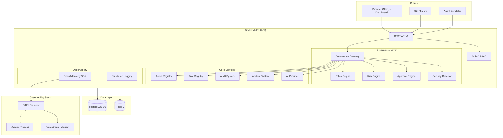

## Agent Execution Lifecycle

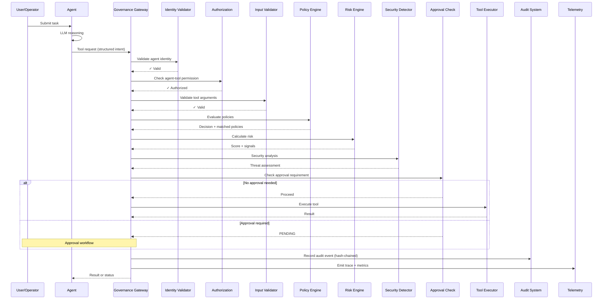

## Governance Gateway Pipeline

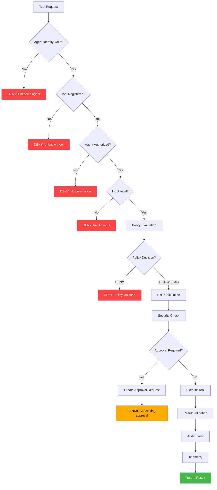

## Agent to Tool Architecture

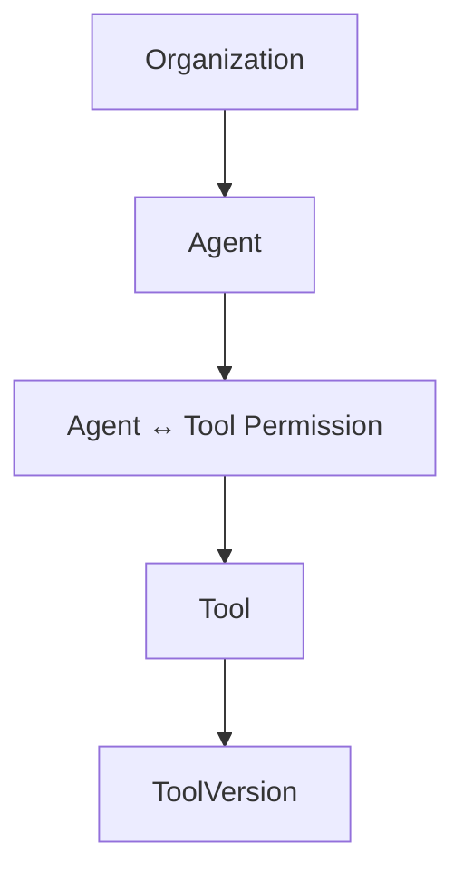


## Database ERD (Core)

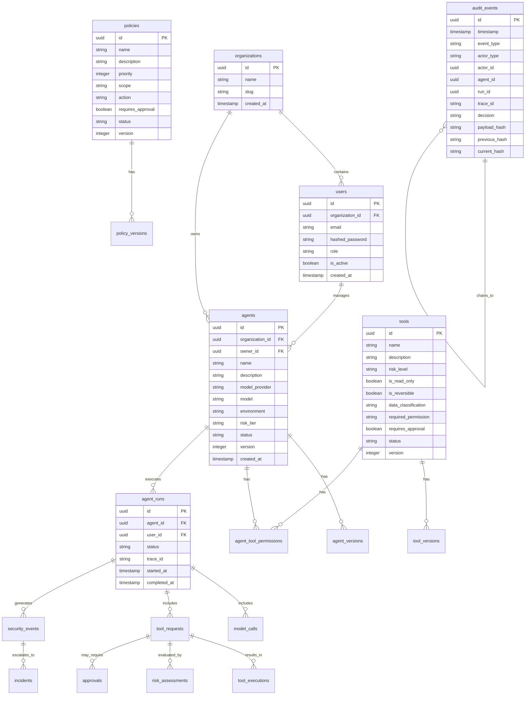

## Audit Hash Chain

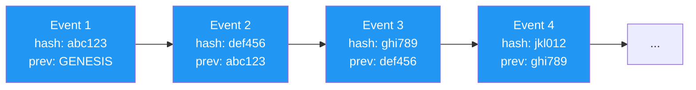

Each event: `current_hash = SHA256(event_data + previous_hash)`

Tampering with any event breaks the chain for all subsequent events.

## Trust Boundaries

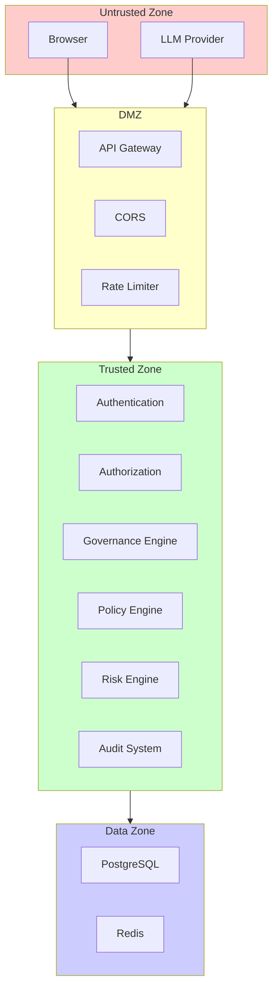

## Service Boundaries

| Service | Responsibility | Dependencies |
|---------|---------------|-------------|
| **API** | HTTP routing, request validation | Auth, all features |
| **Auth** | Authentication, token management | Database |
| **Agent Registry** | Agent CRUD, versioning | Database, Auth |
| **Tool Registry** | Tool CRUD, permissions | Database, Auth |
| **Governance Gateway** | Central control point | Policy, Risk, Approval, Security, Audit |
| **Policy Engine** | Deterministic policy evaluation | Database |
| **Risk Engine** | Risk score calculation | Database |
| **Approval Engine** | Human approval workflow | Database, Redis |
| **Audit System** | Tamper-evident event logging | Database |
| **Security Detector** | Threat detection | Database |
| **Incident System** | Security incident management | Database, Security Detector |
| **AI Provider** | LLM abstraction | External API / Mock |
| **Telemetry** | Tracing, metrics, logging | OTEL Collector |

## Data Flow

```
HTTP Request
  → CORS validation
  → Authentication (JWT)
  → Authorization (RBAC)
  → Request validation (Pydantic)
  → Business logic
  → Database operations (SQLAlchemy async)
  → Response serialization
  → Structured logging
  → Telemetry export
```

## Governance Gateway Architecture (Phase 5)

The Governance Gateway serves as the single deterministic mediation layer through which every agent tool invocation must pass before execution.

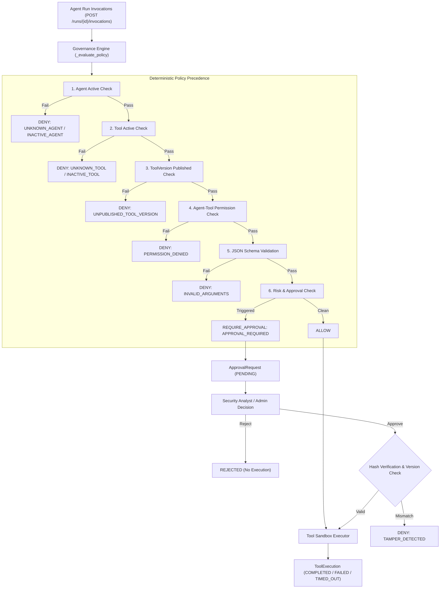

### Governance Data Model Relationships

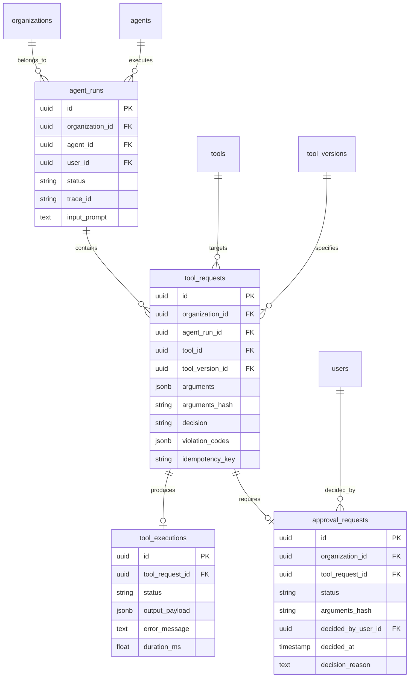

### Execution Sandbox & Isolation Layer

- **Closed Handler Registry:** Execution is dispatched strictly to pre-registered, verified handlers (`calculator`, `echo`, `system-status`, `data-lookup`).
- **No Arbitrary Code:** Arbitrary user strings, Python `eval`/`exec`, or shell invocations are completely rejected.
- **Timeout Isolation:** Asynchronous calls are wrapped in `asyncio.wait_for` with tool-specific timeout thresholds. If exceeded, executions are immediately terminated and persisted with status `TIMED_OUT`.
- **Integrity Verification:** Arguments and tool version IDs are hashed with SHA-256 over canonical JSON. Approvals verify this hash prior to executing the tool, preventing state manipulation.

## Policy Engine Architecture (Phase 6)

The Policy Engine delivers deterministic, declarative, multi-tier rule evaluation for all agent tool requests, executing between baseline platform safety checks and runtime execution.

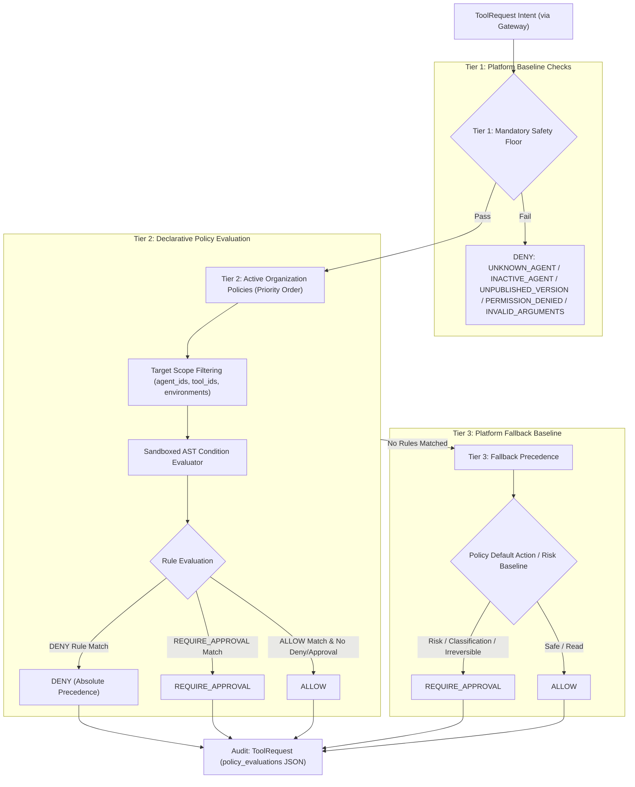

### Policy Engine Domain Model

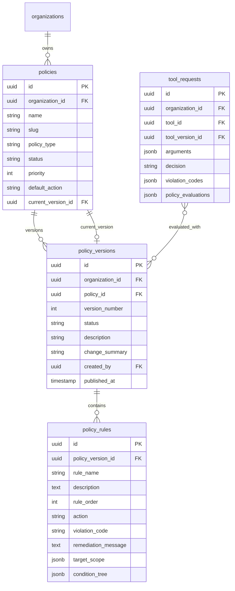

### Policy & Version Lifecycle State Machines

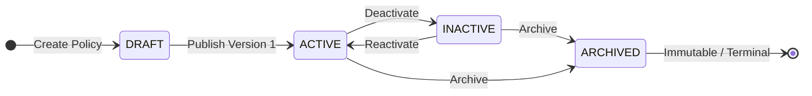

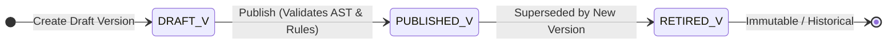

### AST Condition Evaluator Specification

- **Sandboxing:** Dynamic execution functions (`eval`, `exec`, `compile`, `getattr`) are prohibited.
- **Traversal:** Dotted path resolution (`arguments.amount`, `agent.environment`, `tool.name`, `context.risk_level`).
- **Complexity Envelopes:**
  - Max AST tree depth: 5
  - Max condition clauses: 20
  - Max payload size: 64 KB
  - Max string comparison length: 1,024 characters
- **ReDoS Immunity (Google RE2):**
  - Linear-time automata engine (`google-re2`) guaranteeing mathematical $O(n)$ time complexity in input length.
  - Catastrophic backtracking is fundamentally eliminated without relying on worker threads, timeouts, or task queues.
  - Regex pattern length capped at 128 characters, target input string capped at 1,024 characters.
  - Static authoring-time rejection of nested quantifiers, quantified alternations, and non-linear backreferences.

---

## Phase 7 — Risk Engine & 5-Stage Precedence Architecture

The Risk Engine provides deterministic quantitative risk scoring, empirical agent trust tracking, dynamic argument heuristic inspection, and immutable versioned risk configurations.

### 5-Stage Decision Precedence Pipeline


### Risk Engine Domain Model (ERD)

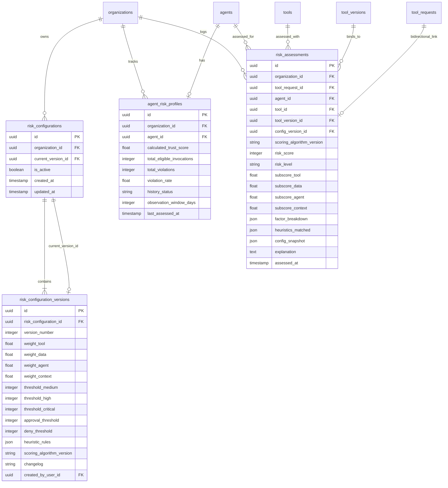

### Four-Vector Quantitative Scoring Specification

1. **Tool Blast Radius Subscore ($S_{\text{tool}}$):**
   $$S_{\text{tool}} = 0.40 \cdot \text{tier\_pts} + 0.30 \cdot \text{access\_pts} + 0.30 \cdot \text{reversibility\_pts}$$
   - Risk Tier: `LOW`: 0.0, `MEDIUM`: 25.0, `HIGH`: 60.0, `CRITICAL`: 100.0.
   - Access Type: `READ`: 0.0, `WRITE`: 50.0.
   - Reversibility: `REVERSIBLE`: 0.0, `IRREVERSIBLE`: 100.0.

2. **Data Classification & Impact Subscore ($S_{\text{data}}$):**
   $$S_{\text{data}} = 0.70 \cdot \text{classification\_pts} + 0.30 \cdot \text{approval\_pts}$$
   - Data Classification: `PUBLIC`: 0.0, `INTERNAL`: 25.0, `CONFIDENTIAL`: 60.0, `RESTRICTED`: 100.0.
   - Approval Requirement: `NOT_REQUIRED`: 0.0, `OPTIONAL`: 50.0, `REQUIRED`: 100.0.

3. **Agent Trust & Violation History Subscore ($S_{\text{agent}}$):**
   $$S_{\text{agent}} = \min(100.0, \text{tier\_pts} + \text{violation\_penalty})$$
   - Risk Tier: `LOW`: 0.0, `MEDIUM`: 25.0, `HIGH`: 60.0, `CRITICAL`: 100.0.
   - 7-day observation window, up to 50 samples.
   - When sample size $N < 5$: status is `INSUFFICIENT_DATA`, violation rate defaults to 0.0, and conservative baseline trust score (100.0) is applied.
   - When $N \ge 5$: status is `VALID`, $\text{violation\_rate} = \text{violations} / N$, and violation penalty applies linearly.

4. **Runtime Context Risk Subscore ($S_{\text{context}}$):**
   $$S_{\text{context}} = \min(100.0, \text{env\_pts} + \sum \text{heuristic\_pts})$$
   - Environment: `DEVELOPMENT`: 0.0, `STAGING`: 25.0, `PRODUCTION`: 60.0.
   - Argument Heuristics: Pattern matches for destructive commands (`rm -rf`, `DROP TABLE`), SQL injections, wildcard scopes (`*`), and large financial thresholds.

5. **Composite Score & Classification:**
   $$S_{\text{composite}} = \text{round}(w_{\text{tool}} S_{\text{tool}} + w_{\text{data}} S_{\text{data}} + w_{\text{agent}} S_{\text{agent}} + w_{\text{context}} S_{\text{context}})$$
   - Classification: `LOW` (0–29), `MEDIUM` (30–59), `HIGH` (60–84), `CRITICAL` (85–100).
   - Enforces default thresholds: `approval_threshold = 60`, `deny_threshold = 90`.
