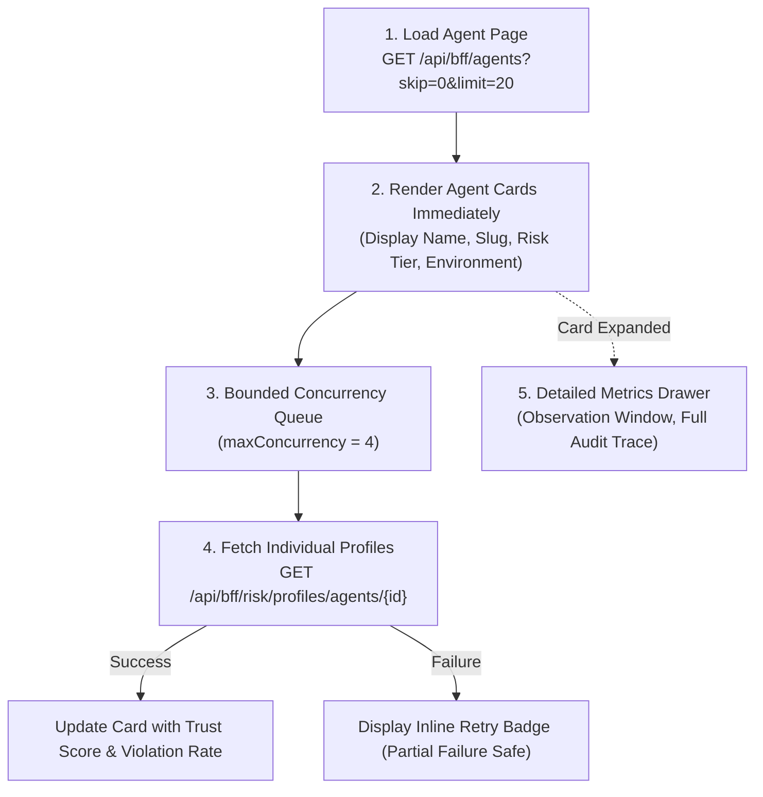
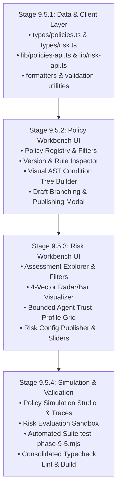

# VERIDEX — PHASE 9.5 ARCHITECTURE SPECIFICATION
## Policy Management & Risk Management Workbenches

**Milestone:** Phase 9.5 — Declarative Policy Authoring, AST Rule Builder, Quantitative Risk Governance, and Simulation Engine  
**Backend Baseline:** FastAPI v0.8.0 (`commit 091f28416c77fc0a38679b54f03b5a4b06731b82`)  
**Frontend Baseline:** Next.js App Router v0.9.4 (`commit 4c4eec046f8c4622479298acbfc068ca1618cf27`)  
**Status:** Finalized Architectural Design — Awaiting Project Owner Authorization for Implementation  

---

## 1. Executive Summary

Phase 9.5 expands the VERIDEX Security Operations Center (SecOps) platform from observational governance (analytics and human-in-the-loop approvals) into active declarative policy management and multi-dimensional quantitative risk control.

The frontend application provides two mission-critical, enterprise-grade workbenches:
1. **Policy Management Workbench (`/policies`):** A declarative rule authoring, lifecycle management, and simulation suite. It supports containerized policies, immutable version branching, an AST-driven visual condition builder, safe regex pattern verification with linear-time guarantees (RE2 semantics), and dry-run policy evaluation.
2. **Risk Management Workbench (`/risk`):** A multi-vector risk engine interface featuring a historical assessment audit explorer, 4-vector factor decomposition (Tool, Data, Agent, Context), bounded empirical agent trust profiling with cold-start detection, live risk simulation, and an immutable scoring configuration publisher.

Both workbenches strictly adhere to the proven VERIDEX architectural invariants:
- **Same-Origin BFF Proxy:** All data flows through `/api/bff/policies/*` and `/api/bff/risk/*`, preserving encrypted HttpOnly session cookies and stripping browser credentials.
- **Five-Role RBAC:** Precise client-side and server-side authorization across `ADMIN`, `SECURITY_ANALYST`, `AUDITOR`, `AGENT_OPERATOR`, and `VIEWER`.
- **Zero Mock Data:** Built entirely on verified v0.8.0 FastAPI endpoints and database-backed entities.
- **Zero New Dependencies:** Implemented using standard React 19, Tailwind CSS, and native Web APIs (SVG charting, native formatted JSON textarea, Web Crypto). No Monaco, Recharts, or third-party charting libraries required.

---

## 2. Verified Current-State Architecture

### 2.1 Backend Baseline (FastAPI v0.8.0)
The backend architecture implements two distinct domain packages under `app/`:
- **`app.policies`:** Declarative policy engine supporting hierarchical AST evaluation, version immutability, ReDoS-safe Google RE2 regex matching, and deterministic conflict resolution.
- **`app.risk`:** Quantitative risk scoring engine calculating composite scores ($0 \dots 100$) across a 4-vector weight model ($\mathbf{W} = [w_{\text{tool}}, w_{\text{data}}, w_{\text{agent}}, w_{\text{context}}]$) with empirical agent violation rates and argument heuristics.

### 2.2 Frontend Baseline (Next.js App Router v0.9.4)
- **Framework:** Next.js 16.3.7 App Router with React 19.2.8, TypeScript 5, and Tailwind CSS 4.
- **Security & Session:** Encrypted HttpOnly cookie session storage (`iron-session` compatible via Web Crypto API `aes-256-gcm`). Browser-facing requests contain zero JWT tokens.
- **BFF Proxy Handler (`/api/bff/[...path]/route.ts`):** Already has `"policies"` and `"risk"` registered in `ALLOWED_API_DOMAINS`. Enforces CSRF token/origin validation for state-mutating requests (`POST`, `PUT`, `PATCH`, `DELETE`).
- **Permissions Framework (`src/lib/permissions.ts`):** Contains established RBAC helpers: `canManagePolicies`, `canManageRiskConfig`, and `canSimulatePolicies`.
- **Existing Placeholder Shells:** `src/app/policies/page.tsx` and `src/app/risk/page.tsx` currently render preliminary Phase 9.2 placeholder cards and role guards.

---

## 3. Backend Endpoint Inventory (20 Audited Endpoints)

The implementation interacts with exactly 20 backend REST endpoints (14 Policy endpoints and 6 Risk endpoints), all verified against `backend/app/api/v1/policies.py` and `backend/app/api/v1/risk.py`.

### 3.1 Workstream A: Policy Engine Endpoints (14 Total)

| # | HTTP Method | Backend Endpoint | BFF Endpoint Path | Authorized Roles | Description |
|---|-------------|------------------|-------------------|------------------|-------------|
| 1 | `POST` | `/api/v1/policies` | `/api/bff/policies` | `ADMIN`, `SECURITY_ANALYST` | Create policy container + initial DRAFT v1 version |
| 2 | `GET` | `/api/v1/policies` | `/api/bff/policies` | All 5 Roles | List policies with type/status filters and pagination |
| 3 | `GET` | `/api/v1/policies/{id}` | `/api/bff/policies/{id}` | All 5 Roles | Get full policy detail with active version & rules |
| 4 | `PUT` / `PATCH` | `/api/v1/policies/{id}` | `/api/bff/policies/{id}` | `ADMIN`, `SECURITY_ANALYST` | Update policy metadata and priority |
| 5 | `PATCH` | `/api/v1/policies/{id}/status` | `/api/bff/policies/{id}/status` | `ADMIN`, `SECURITY_ANALYST` | Transition policy lifecycle state |
| 6 | `DELETE` | `/api/v1/policies/{id}` | `/api/bff/policies/{id}` | `ADMIN`, `SECURITY_ANALYST` | Soft-delete policy (transitions to ARCHIVED) |
| 7 | `POST` | `/api/v1/policies/{id}/versions` | `/api/bff/policies/{id}/versions` | `ADMIN`, `SECURITY_ANALYST` | Branch new DRAFT version cloning current rules |
| 8 | `GET` | `/api/v1/policies/{id}/versions` | `/api/bff/policies/{id}/versions` | All 5 Roles | List all historical versions for a policy |
| 9 | `GET` | `/api/v1/policies/{id}/versions/{version_id}` | `/api/bff/policies/{id}/versions/{version_id}` | All 5 Roles | Get version detail and rule snapshot |
| 10 | `POST` | `/api/v1/policies/{id}/versions/{version_id}/publish` | `/api/bff/policies/{id}/versions/{version_id}/publish` | `ADMIN`, `SECURITY_ANALYST` | Validate rules, freeze version, activate atomically |
| 11 | `POST` | `/api/v1/policies/{id}/versions/{version_id}/rules` | `/api/bff/policies/{id}/versions/{version_id}/rules` | `ADMIN`, `SECURITY_ANALYST` | Add rule to DRAFT version (409 on PUBLISHED) |
| 12 | `PUT` / `PATCH` | `/api/v1/policies/{id}/versions/{version_id}/rules/{rule_id}` | `/api/bff/policies/{id}/versions/{version_id}/rules/{rule_id}` | `ADMIN`, `SECURITY_ANALYST` | Update rule in DRAFT version (409 on PUBLISHED) |
| 13 | `DELETE` | `/api/v1/policies/{id}/versions/{version_id}/rules/{rule_id}` | `/api/bff/policies/{id}/versions/{version_id}/rules/{rule_id}` | `ADMIN`, `SECURITY_ANALYST` | Delete rule from DRAFT version (409 on PUBLISHED) |
| 14 | `POST` | `/api/v1/policies/simulate` | `/api/bff/policies/simulate` | `ADMIN`, `SECURITY_ANALYST`, `AUDITOR`, `AGENT_OPERATOR` *(VIEWER: 403)* | Dry-run policy simulation against hypothetical input |

### 3.2 Workstream B: Risk Engine Endpoints (6 Total)

| # | HTTP Method | Backend Endpoint | BFF Endpoint Path | Authorized Roles | Description |
|---|-------------|------------------|-------------------|------------------|-------------|
| 15 | `POST` | `/api/v1/risk/evaluate` | `/api/bff/risk/evaluate` | All 5 Roles | Dry-run quantitative risk simulation without persistence |
| 16 | `GET` | `/api/v1/risk/assessments` | `/api/bff/risk/assessments` | All 5 Roles | Filtered, paginated list of historical assessments |
| 17 | `GET` | `/api/v1/risk/assessments/{id}` | `/api/bff/risk/assessments/{id}` | All 5 Roles | Retrieve single immutable risk assessment record |
| 18 | `GET` | `/api/v1/risk/profiles/agents/{agent_id}` | `/api/bff/risk/profiles/agents/{agent_id}` | All 5 Roles | Sliding-window empirical risk profile & trust metrics |
| 19 | `GET` | `/api/v1/risk/config` | `/api/bff/risk/config` | All 5 Roles | Active risk configuration and version snapshot |
| 20 | `POST` | `/api/v1/risk/config/versions` | `/api/bff/risk/config/versions` | `ADMIN`, `SECURITY_ANALYST` | Publish new immutable risk configuration version |

---

## 4. Exact Backend API Request & Response Contracts

The structures below reflect the exact v0.8.0 Pydantic schema definitions, field types, validation constraints, and defaults from `backend/app/policies/schemas.py` and `backend/app/risk/schemas.py`.

### 4.1 Policy Domain Contracts

#### 4.1.1 TargetScopeSchema
Scoping criteria defining when a rule applies (`backend/app/policies/schemas.py`):
```typescript
export interface TargetScopeSchema {
  agent_ids: string[];                 // list[str], default []
  agent_environments: string[];        // list[str], default []
  agent_risk_tiers: string[];          // list[str], default []
  tool_ids: string[];                  // list[str], default []
  tool_risk_levels: string[];          // list[str], default []
  tool_access_types: string[];         // list[str], default []
  tool_data_classifications: string[]; // list[str], default []
}
```

#### 4.1.2 PolicyRuleCreate & PolicyRuleUpdate
Payloads for rule creation and modification within a `DRAFT` version:
```typescript
export type PolicyAction = "ALLOW" | "DENY" | "REQUIRE_APPROVAL";

export interface PolicyRuleCreate {
  rule_name: string;                   // min_length=1, max_length=255, required
  description?: string | null;         // max_length=1000, default null
  rule_order?: number;                 // ge=1, default 1
  action?: PolicyAction;               // default "DENY"
  violation_code?: string;             // max_length=100, default "POLICY_VIOLATION"
  remediation_message?: string | null; // max_length=1000, default null
  target_scope?: TargetScopeSchema;    // default empty lists
  condition_tree?: Record<string, unknown>; // dict, default {}
  is_enabled?: boolean;                // default true
}

export interface PolicyRuleUpdate {
  rule_name?: string | null;           // min_length=1, max_length=255
  description?: string | null;         // max_length=1000
  rule_order?: number | null;          // ge=1
  action?: PolicyAction | null;
  violation_code?: string | null;      // max_length=100
  remediation_message?: string | null; // max_length=1000
  target_scope?: TargetScopeSchema | null;
  condition_tree?: Record<string, unknown> | null;
  is_enabled?: boolean | null;
}
```

#### 4.1.3 PolicyCreate & PolicyUpdate
Payloads for policy container authoring and modification:
```typescript
export type PolicyType = "SECURITY" | "OPERATIONAL" | "COMPLIANCE" | "FINANCIAL";
export type PolicyStatus = "DRAFT" | "ACTIVE" | "INACTIVE" | "ARCHIVED";

export interface PolicyCreate {
  name: string;                        // min_length=1, max_length=255, required
  slug?: string | null;                // max_length=255, default null (backend auto-slugifies if omitted)
  description?: string | null;         // max_length=1000, default null
  policy_type?: PolicyType;            // default "SECURITY"
  priority?: number;                   // ge=1, le=10000, default 100 (lower number = higher priority)
  default_action?: PolicyAction;       // default "DENY"
  initial_rules?: PolicyRuleCreate[];  // default [] (attached to auto-created v1 DRAFT version)
}

export interface PolicyUpdate {
  name?: string | null;                // min_length=1, max_length=255
  description?: string | null;         // max_length=1000
  policy_type?: PolicyType | null;
  priority?: number | null;            // ge=1, le=10000
  default_action?: PolicyAction | null;
}
```

#### 4.1.4 Policy Response Models
```typescript
export interface PolicyRuleResponse {
  id: string;                          // UUID
  policy_version_id: string;           // UUID
  rule_name: string;
  description: string | null;
  rule_order: number;
  action: PolicyAction;
  violation_code: string;
  remediation_message: string | null;
  target_scope: TargetScopeSchema;     // JSON object matching TargetScopeSchema
  condition_tree: Record<string, unknown>;
  is_enabled: boolean;
  created_at: string;                  // ISO 8601
  updated_at: string;
}

export type PolicyVersionStatus = "DRAFT" | "PUBLISHED" | "RETIRED";

export interface PolicyVersionResponse {
  id: string;                          // UUID
  policy_id: string;                   // UUID
  version_number: number;
  status: PolicyVersionStatus;
  changelog: string | null;
  published_by_user_id: string | null;
  published_at: string | null;         // ISO 8601
  created_at: string;
  rules: PolicyRuleResponse[];
}

export interface PolicyResponse {
  id: string;                          // UUID
  organization_id: string;             // UUID
  name: string;
  slug: string;
  description: string | null;
  policy_type: PolicyType;
  status: PolicyStatus;
  priority: number;
  default_action: PolicyAction;
  current_version_id: string | null;   // UUID
  created_at: string;
  updated_at: string;
  current_version?: PolicyVersionResponse | null;
}

export interface PolicyListResponse {
  items: PolicyResponse[];
  total: number;
}
```

---

### 4.2 Risk Domain Contracts

#### 4.2.1 RiskEvaluateRequest (Backend: `RiskSimulateRequest`)
Payload for `POST /api/v1/risk/evaluate`:
```typescript
export interface RiskEvaluateRequest {
  agent_id: string;                    // UUID, required
  tool_id: string;                     // UUID, required
  tool_version_id: string;             // UUID, required
  arguments?: Record<string, unknown>; // dict, default {}
  environment?: string;                // max_length=50, default "DEVELOPMENT"
}
```

#### 4.2.2 RiskEvaluateResponse (Backend: `RiskSimulateResponse`)
Response from `POST /api/v1/risk/evaluate`:
```typescript
export type RiskLevel = "LOW" | "MEDIUM" | "HIGH" | "CRITICAL";

export interface SubscoresBreakdown {
  tool: number;                        // float, 0.0 .. 100.0
  data: number;                        // float, 0.0 .. 100.0
  agent: number;                       // float, 0.0 .. 100.0
  context: number;                     // float, 0.0 .. 100.0
}

export interface HeuristicMatch {
  rule_id: string;
  path: string;
  severity: string;
  score_contribution: number;
}

export interface RiskEvaluateResponse {
  risk_score: number;                  // int, ge=0, le=100
  risk_level: RiskLevel;
  subscores: SubscoresBreakdown;
  factor_breakdown: Record<string, unknown>;
  heuristics_matched: HeuristicMatch[];
  config_snapshot: Record<string, unknown>;
  explanation: string;
  scoring_algorithm_version: string;   // default "1.0.0"
  assessed_at: string;                 // ISO 8601
  config_version_id: string | null;    // UUID
}
```

#### 4.2.3 Risk Assessment Query Parameters & Listing
Exact parameters for `GET /api/v1/risk/assessments` (`backend/app/api/v1/risk.py`):

| Parameter | Type | Required | Default | Bounds & Validation | Description |
|---|---|:---:|:---:|---|---|
| `agent_id` | `string` (UUID) | No | `null` | Must parse to valid UUID if supplied | Filter by executing agent ID |
| `tool_id` | `string` (UUID) | No | `null` | Must parse to valid UUID if supplied | Filter by invoked tool ID |
| `risk_level` | `string` (Enum) | No | `null` | `"LOW"`, `"MEDIUM"`, `"HIGH"`, `"CRITICAL"` | Filter by assigned risk classification |
| `start_date` | `string` (ISO datetime) | No | `null` | Valid ISO 8601 format | Filter assessments assessed $\ge$ start_date |
| `end_date` | `string` (ISO datetime) | No | `null` | Valid ISO 8601 format | Filter assessments assessed $\le$ end_date |
| `limit` | `integer` | No | `50` | `ge=1, le=100` (FastAPI returns 422 if violated) | Page size |
| `offset` | `integer` | No | `0` | `ge=0` (FastAPI returns 422 if violated) | Page offset |

```typescript
export interface RiskAssessmentResponse {
  id: string;                          // UUID
  organization_id: string;             // UUID
  tool_request_id: string | null;      // UUID
  agent_id: string;                    // UUID
  tool_id: string;                     // UUID
  tool_version_id: string;             // UUID
  config_version_id: string | null;    // UUID
  scoring_algorithm_version: string;
  risk_score: number;                  // int, 0 .. 100
  risk_level: RiskLevel;
  subscore_tool: number;
  subscore_data: number;
  subscore_agent: number;
  subscore_context: number;
  factor_breakdown: Record<string, unknown>;
  heuristics_matched: HeuristicMatch[];
  config_snapshot: Record<string, unknown>;
  explanation: string | null;
  assessed_at: string;
  created_at: string;
}

export interface RiskAssessmentListResponse {
  items: RiskAssessmentResponse[];
  total: number;
}
```

---

## 5. Policy Management Workbench Design (`/policies`)

### 5.1 Sub-Navigation & Page Layout
The Policy Workbench maintains a top-level tabbed sub-navigation bar:
- **Registry (`tab=registry`):** Searchable, filterable policy inventory with status pills, priority tags, and version status.
- **Detail & Versions (`tab=detail&id={policy_id}`):** Container overview, active published version, rule execution order, and historical version timeline.
- **Rule Authoring Studio (`tab=editor&id={policy_id}&version={version_id}`):** Draft editor for policy rules. Published versions are strictly read-only.
- **Simulation Studio (`tab=simulation`):** Interactive sandbox for dry-run evaluation.

### 5.2 Immutable Versioning Lifecycle
- **DRAFT:** Rules can be added, updated, reordered, or deleted.
- **PUBLISHED:** Version is frozen. Attempting rule mutations returns **HTTP 409 Conflict**.
- **Branching Action:** To edit a published policy, the operator clicks **"Branch New Draft Version"** (`POST /api/bff/policies/{id}/versions?changelog=...`), which clones all existing rules into a new `DRAFT` version with an incremented version number.

### 5.3 AST Condition Tree Builder
Visual condition builder implementing Google RE2 linear-time semantics:
- Maximum nesting depth: 5 levels (`MAX_AST_DEPTH = 5`).
- Maximum conditions per rule: 20 leaf nodes (`MAX_CONDITIONS_PER_RULE = 20`).
- Maximum regex pattern length: 128 characters (`MAX_REGEX_LEN = 128`).
- Static client-side ReDoS validator flags nested quantifiers (e.g. `(a+)+`) before submission.

### 5.4 Simulation Editor Architecture (Zero-Dependency Implementation)
Inspection of `frontend/package.json` confirms no code editor packages (Monaco, CodeMirror, Ace) are installed. To avoid introducing heavy external dependencies, the Simulation Editor uses a robust, native implementation:
1. **Target Selectors:**
   - **Agent Selector:** Native accessible dropdown populated via `GET /api/bff/agents?limit=100`.
   - **Tool Selector:** Native dropdown populated via `GET /api/bff/tools?limit=100`.
   - **Tool Version Selector:** Dropdown populated via `GET /api/bff/tools/{tool_id}/versions`.
2. **Arguments JSON Editor:**
   - Native HTML `<textarea>` styled with Tailwind dark terminal aesthetics (`bg-gray-950 text-emerald-400 font-mono text-xs border-gray-800 focus:border-indigo-500 rounded-lg p-3`).
   - Real-time client-side JSON parsing with inline error reporting (capturing exact line and syntax error if malformed).
   - **"Format JSON" Action:** Automatically formats the input via `JSON.stringify(JSON.parse(val), null, 2)`.
   - **"Load Template" Action:** Pre-populates sample arguments from the tool's `input_schema` if available.

---

## 6. Risk Management Workbench Design (`/risk`)

### 6.1 Sub-Navigation & Page Layout
- **Risk Explorer (`tab=assessments`):** Paginated assessment audit log with risk level filters, agent/tool filters, and date range filters.
- **Assessment Deep-Dive Drawer (`assessment_id={id}`):** Slide-out drawer displaying 4-vector decomposition, heuristic matches, and explanation.
- **Agent Trust Profiles (`tab=profiles`):** Grid of agent trust cards with empirical metrics and cold-start indicators.
- **Scoring Configuration (`tab=config`):** Active 4-vector weights ($\sum w = 1.0$), threshold step-meters, and configuration version publisher.
- **Risk Simulation (`tab=simulation`):** Dry-run risk scoring playground.

### 6.2 4-Vector Quantitative Scoring Visualization
Native responsive SVG visualizations:
- **Composite Score Gauge:** Circular progress meter colored by risk band (`LOW`=Green, `MEDIUM`=Blue/Yellow, `HIGH`=Orange, `CRITICAL`=Red).
- **Factor Decomposition Radar / Bar:** Responsive SVG showing normalized subscores:
  - $S_{\text{tool}}$ (Tool blast radius, reversibility, access type)
  - $S_{\text{data}}$ (Target data classification)
  - $S_{\text{agent}}$ (Agent risk tier, violation history, trust score)
  - $S_{\text{context}}$ (Environment, argument heuristics)

### 6.3 Agent Trust Profile Bounded Loading Strategy
The backend provides an empirical profile endpoint per agent (`GET /api/v1/risk/profiles/agents/{agent_id}`). There is no bulk endpoint. To guarantee rapid rendering, network hygiene, and scalability:



#### Detailed Specification:
1. **Bounded Agent Pagination:**
   - The profile grid uses the agent registry endpoint: `GET /api/bff/agents?skip={skip}&limit=20` (Note: backend parameter is `skip`, not `offset`).
   - Default page size is 20 agents.
2. **Bounded Concurrency Pool:**
   - When 20 agents are displayed, the frontend executes profile fetches through a client-side concurrency limiter (`maxConcurrency = 4`).
   - At most 4 HTTP requests are in-flight concurrently, eliminating connection starvation and API gateway rate-limiting.
3. **Partial Failure Isolation:**
   - If an individual profile fetch fails (e.g. 404 for an agent without history, or network timeout), only that specific card displays an inline badge: *"Trust Profile Unavailable (Retry)"*.
   - The remaining 19 cards continue loading and rendering normally. The page never crashes on partial failure.
4. **Retry Behavior:**
   - Transient failures trigger up to 2 automatic retries with exponential backoff ($500\text{ms}, 1500\text{ms}$).
   - Failed cards provide a manual 1-click **Retry** button.
5. **Two-Tier Loading (Lazy Deep-Dive):**
   - **Grid Card Tier:** Eagerly fetches summary metrics (`calculated_trust_score`, `violation_rate`, `history_status`).
   - **Drawer Tier:** If the user expands an agent card or opens the detailed history drawer, the component fetches any extended assessment records filtered by `agent_id={id}`.

---

## 7. Five-Role Permission Matrix for Phase 9.5

The frontend strictly enforces backend endpoint permissions. The matrix below defines the UI visibility and action authorization:

| Action / Capability | Backend Endpoint | ADMIN | SECURITY_ANALYST | AUDITOR | AGENT_OPERATOR | VIEWER |
|---|---|:---:|:---:|:---:|:---:|:---:|
| **Access `/policies` Route** | Next.js Page Guard | Allowed | Allowed | Allowed | Allowed | Allowed |
| **List & View Policies** | `GET /api/v1/policies` | Allowed | Allowed | Allowed | Allowed | Allowed |
| **Create Policy Container** | `POST /api/v1/policies` | **Allowed** | **Allowed** | Blocked | Blocked | Blocked |
| **Update Policy Metadata** | `PUT/PATCH /api/v1/policies/{id}` | **Allowed** | **Allowed** | Blocked | Blocked | Blocked |
| **Change Policy Status** | `PATCH /api/v1/policies/{id}/status` | **Allowed** | **Allowed** | Blocked | Blocked | Blocked |
| **Archive (Delete) Policy** | `DELETE /api/v1/policies/{id}` | **Allowed** | **Allowed** | Blocked | Blocked | Blocked |
| **Branch New Version** | `POST /api/v1/policies/{id}/versions` | **Allowed** | **Allowed** | Blocked | Blocked | Blocked |
| **Publish Policy Version** | `POST .../versions/{id}/publish` | **Allowed** | **Allowed** | Blocked | Blocked | Blocked |
| **Mutate Draft Rules** | `POST/PUT/DELETE .../rules/*` | **Allowed** | **Allowed** | Blocked | Blocked | Blocked |
| **Simulate Policies** | `POST /api/v1/policies/simulate` | **Allowed** | **Allowed** | **Allowed** | **Allowed** | **Blocked (403)** |
| **Access `/risk` Route** | Next.js Page Guard | Allowed | Allowed | Allowed | Allowed | Allowed |
| **List Risk Assessments** | `GET /api/v1/risk/assessments` | Allowed | Allowed | Allowed | Allowed | Allowed |
| **View Assessment Detail** | `GET /api/v1/risk/assessments/{id}` | Allowed | Allowed | Allowed | Allowed | Allowed |
| **View Agent Risk Profile** | `GET /api/v1/risk/profiles/agents/{id}` | Allowed | Allowed | Allowed | Allowed | Allowed |
| **Simulate Risk Evaluation**| `POST /api/v1/risk/evaluate` | Allowed | Allowed | Allowed | Allowed | Allowed |
| **View Active Risk Config** | `GET /api/v1/risk/config` | Allowed | Allowed | Allowed | Allowed | Allowed |
| **Publish Risk Config** | `POST /api/v1/risk/config/versions` | **Allowed** | **Allowed** | Blocked | Blocked | Blocked |

> [!IMPORTANT]
> **Viewer Role Simulation Restriction:** Notice that `POST /api/v1/policies/simulate` explicitly blocks the `VIEWER` role with HTTP 403 Forbidden, whereas `POST /api/v1/risk/evaluate` allows all 5 roles. The UI condition for the Policy Simulation action uses `canSimulatePolicies`, disabling the run button with a descriptive tooltip for `VIEWER` users.

---

## 8. Route and Component Architecture

All components will reside within modular directories under `src/components/policies/` and `src/components/risk/`.

```
frontend/src/
├── app/
│   ├── policies/
│   │   └── page.tsx                   # Policy Workbench host page (Tabs: registry, detail, editor, simulation)
│   └── risk/
│       └── page.tsx                   # Risk Workbench host page (Tabs: assessments, profiles, config, simulation)
├── components/
│   ├── policies/
│   │   ├── policy-registry-table.tsx  # Searchable policy table with type/status filters
│   │   ├── policy-header.tsx          # Workbench header with "New Policy" and "Simulate" CTAs
│   │   ├── policy-detail-view.tsx     # Policy container overview, active rules & version history
│   │   ├── policy-version-drawer.tsx  # Version list and changelog inspection drawer
│   │   ├── policy-rule-editor.tsx     # Visual rule form (order, action, scope, condition tree)
│   │   ├── ast-condition-builder.tsx  # Recursive tree builder (AND/OR/NOT blocks & leaf conditions)
│   │   ├── ast-condition-node.tsx     # Leaf condition editor (field path, operator, value)
│   │   ├── policy-simulation-panel.tsx# Simulation runner with Agent/Tool selectors & argument JSON textarea
│   │   ├── policy-trace-viewer.tsx    # Visual trace inspector for matched rules & decisions
│   │   ├── policy-status-badge.tsx    # Type-safe badge (DRAFT, ACTIVE, INACTIVE, ARCHIVED)
│   │   └── policy-skeleton.tsx        # Loading skeleton states
│   └── risk/
│       ├── risk-header.tsx            # Workbench header with tab switcher and config action
│       ├── risk-assessment-table.tsx  # Paginated table with risk level badges & subscore bars
│       ├── risk-assessment-filters.tsx# Filter toolbar (level, agent, tool, date range)
│       ├── risk-assessment-drawer.tsx # Slide-out drawer with 4-vector decomposition
│       ├── risk-vector-breakdown.tsx  # Native SVG 4-vector bar & radar visualization
│       ├── agent-risk-profile-grid.tsx# Concurrency-bounded grid of agent trust cards & cold-start indicators
│       ├── agent-trust-badge.tsx      # Trust score meter and tier indicator
│       ├── risk-config-publisher.tsx  # Weight sliders, threshold inputs, & publication modal
│       ├── risk-simulation-panel.tsx  # Live risk dry-run sandbox with argument heuristics
│       └── risk-skeleton.tsx          # Loading skeletons for tables and charts
├── lib/
│   ├── policies/
│   │   ├── policies-api.ts            # Typed BFF client for all 14 policy endpoints
│   │   ├── policies-formatters.ts     # Helpers for slug generation, status colors, AST validation
│   │   └── use-policies.ts            # State hook with optimistic caching and mutation handlers
│   └── risk/
│       ├── risk-api.ts                # Typed BFF client for all 6 risk endpoints
│       ├── risk-formatters.ts         # Scoring calculations, risk level colors, vector formats
│       └── use-risk.ts                # State hook for assessments, profiles, and config
└── types/
    ├── policies.ts                    # TypeScript interfaces for policies, versions, AST rules
    └── risk.ts                        # TypeScript interfaces for assessments, profiles, config
```

---

## 9. API Integration Strategy (BFF Client Layer)

### 9.1 Base Route Registration
The Next.js generic proxy at `/api/bff/[...path]/route.ts` forwards requests to FastAPI `/api/v1/[...path]`.
- Frontend calls `/api/bff/policies?limit=50` $\to$ Backend evaluates `/api/v1/policies?limit=50`.
- Mutating calls (`POST`, `PUT`, `PATCH`, `DELETE`) pass CSRF verification and session decryption.

### 9.2 Policies BFF Client (`src/lib/policies/policies-api.ts`)
```typescript
import { bffFetch } from "@/lib/bff-client";
import type {
  PolicyListResponse,
  PolicyResponse,
  PolicyCreate,
  PolicyUpdate,
  PolicyStatus,
  PolicyVersionResponse,
  PolicyRuleResponse,
  PolicyRuleCreate,
  PolicyRuleUpdate,
} from "@/types/policies";

export const policiesApi = {
  list: (params?: { policy_type?: string; status?: string; limit?: number; offset?: number }) => {
    const search = new URLSearchParams();
    if (params?.policy_type) search.set("policy_type", params.policy_type);
    if (params?.status) search.set("status", params.status);
    if (params?.limit) search.set("limit", String(params.limit));
    if (params?.offset) search.set("offset", String(params.offset));
    return bffFetch<PolicyListResponse>(`/api/bff/policies?${search.toString()}`);
  },

  get: (policyId: string) => bffFetch<PolicyResponse>(`/api/bff/policies/${policyId}`),

  create: (payload: PolicyCreate) =>
    bffFetch<PolicyResponse>("/api/bff/policies", {
      method: "POST",
      headers: { "Content-Type": "application/json" },
      body: JSON.stringify(payload),
    }),

  update: (policyId: string, payload: PolicyUpdate) =>
    bffFetch<PolicyResponse>(`/api/bff/policies/${policyId}`, {
      method: "PUT",
      headers: { "Content-Type": "application/json" },
      body: JSON.stringify(payload),
    }),

  updateStatus: (policyId: string, newStatus: PolicyStatus) =>
    bffFetch<PolicyResponse>(`/api/bff/policies/${policyId}/status?new_status=${newStatus}`, {
      method: "PATCH",
    }),

  delete: (policyId: string) =>
    bffFetch<void>(`/api/bff/policies/${policyId}`, { method: "DELETE" }),

  listVersions: (policyId: string) =>
    bffFetch<PolicyVersionResponse[]>(`/api/bff/policies/${policyId}/versions`),

  getVersion: (policyId: string, versionId: string) =>
    bffFetch<PolicyVersionResponse>(`/api/bff/policies/${policyId}/versions/${versionId}`),

  branchVersion: (policyId: string, changelog?: string) => {
    const q = changelog ? `?changelog=${encodeURIComponent(changelog)}` : "";
    return bffFetch<PolicyVersionResponse>(`/api/bff/policies/${policyId}/versions${q}`, {
      method: "POST",
    });
  },

  publishVersion: (policyId: string, versionId: string) =>
    bffFetch<PolicyVersionResponse>(`/api/bff/policies/${policyId}/versions/${versionId}/publish`, {
      method: "POST",
    }),

  createRule: (policyId: string, versionId: string, payload: PolicyRuleCreate) =>
    bffFetch<PolicyRuleResponse>(`/api/bff/policies/${policyId}/versions/${versionId}/rules`, {
      method: "POST",
      headers: { "Content-Type": "application/json" },
      body: JSON.stringify(payload),
    }),

  updateRule: (policyId: string, versionId: string, ruleId: string, payload: PolicyRuleUpdate) =>
    bffFetch<PolicyRuleResponse>(`/api/bff/policies/${policyId}/versions/${versionId}/rules/${ruleId}`, {
      method: "PUT",
      headers: { "Content-Type": "application/json" },
      body: JSON.stringify(payload),
    }),

  deleteRule: (policyId: string, versionId: string, ruleId: string) =>
    bffFetch<void>(`/api/bff/policies/${policyId}/versions/${versionId}/rules/${ruleId}`, {
      method: "DELETE",
    }),

  simulate: (payload: { agent_id: string; tool_id: string; tool_version_id: string; arguments?: Record<string, unknown>; environment?: string }) =>
    bffFetch<unknown>("/api/bff/policies/simulate", {
      method: "POST",
      headers: { "Content-Type": "application/json" },
      body: JSON.stringify(payload),
    }),
};
```

### 9.3 Risk BFF Client (`src/lib/risk/risk-api.ts`)
```typescript
import { bffFetch } from "@/lib/bff-client";
import type {
  RiskAssessmentListResponse,
  RiskAssessmentResponse,
  RiskEvaluateRequest,
  RiskEvaluateResponse,
} from "@/types/risk";

export const riskApi = {
  listAssessments: (params?: {
    agent_id?: string;
    tool_id?: string;
    risk_level?: string;
    start_date?: string;
    end_date?: string;
    limit?: number;
    offset?: number;
  }) => {
    const search = new URLSearchParams();
    if (params?.agent_id) search.set("agent_id", params.agent_id);
    if (params?.tool_id) search.set("tool_id", params.tool_id);
    if (params?.risk_level) search.set("risk_level", params.risk_level);
    if (params?.start_date) search.set("start_date", params.start_date);
    if (params?.end_date) search.set("end_date", params.end_date);
    if (params?.limit) search.set("limit", String(params.limit));
    if (params?.offset) search.set("offset", String(params.offset));
    return bffFetch<RiskAssessmentListResponse>(`/api/bff/risk/assessments?${search.toString()}`);
  },

  getAssessment: (assessmentId: string) =>
    bffFetch<RiskAssessmentResponse>(`/api/bff/risk/assessments/${assessmentId}`),

  getAgentProfile: (agentId: string) =>
    bffFetch<unknown>(`/api/bff/risk/profiles/agents/${agentId}`),

  getActiveConfig: () =>
    bffFetch<unknown>("/api/bff/risk/config"),

  publishConfigVersion: (payload: unknown) =>
    bffFetch<unknown>("/api/bff/risk/config/versions", {
      method: "POST",
      headers: { "Content-Type": "application/json" },
      body: JSON.stringify(payload),
    }),

  evaluate: (payload: RiskEvaluateRequest) =>
    bffFetch<RiskEvaluateResponse>("/api/bff/risk/evaluate", {
      method: "POST",
      headers: { "Content-Type": "application/json" },
      body: JSON.stringify(payload),
    }),
};
```

---

## 10. Security, Mutation Safeguards, and Tenant Isolation

### 10.1 Tenant Isolation Invariants
- Every database query in FastAPI scopes records strictly by `organization_id` derived from the session JWT.
- Browser requests never supply `organization_id`; cross-tenant access is structurally prevented.

### 10.2 Robust Mutation Safeguards
To protect system integrity during state modifications:
1. **Backend-Confirmed State Updates:**
   - No naive optimistic state updates for consequential mutations (policy publishing, version branching, rule creation/deletion, policy archiving, risk configuration publishing).
   - UI awaits explicit HTTP 200/201/204 response from the BFF before updating local state or caches.
2. **Explicit Confirmation Dialogs:**
   - **Archiving Policy (`DELETE /policies/{id}`):** Requires confirmation modal with policy name and prominent warning that active enforcement will cease.
   - **Publishing Policy Version (`POST .../publish`):** Requires review modal summarizing total rules, changelog, and confirmation that the version will be permanently frozen and previous versions retired.
   - **Publishing Risk Configuration (`POST /risk/config/versions`):** Requires review modal confirming the new weights ($\sum = 1.0$), threshold shifts, and immediate application to runtime scoring.
3. **Duplicate-Submission Prevention:**
   - Action buttons are disabled (`disabled={isSubmitting}`) with loading spinners immediately upon submission.
   - Background polling is paused while any mutation modal or in-flight request is pending (preventing race conditions).
   - In-flight guards (`isMutating.current`) reject duplicate clicks.
4. **Graceful HTTP 409 Conflict Handling:**
   - Attempting to mutate rules on a `PUBLISHED` version catches HTTP 409 and presents an actionable banner: *"This version is published and immutable. Branch a new draft version to make changes."* with a direct **Branch Draft** button.
   - Duplicate policy slug catches HTTP 409 and highlights the name/slug field: *"A policy with this slug already exists."*
5. **Precise HTTP 422 Unprocessable Content Handling:**
   - Policy Rule AST depth (>5), condition count (>20), or ReDoS regex patterns map to field-level error messages directly below the offending rule builder node.
   - Risk Configuration weight sums $\ne 1.0$ or inverted thresholds display real-time warning meters: *"Total weights must sum exactly to 1.00 (Current: {sum})"*.

---

## 11. UI Workflows and Interaction Descriptions

### 11.1 Workflow A: Authoring & Publishing a Policy Rule
1. **Navigate to Policies:** User clicks **Policies** in the sidebar. The system checks `canManagePolicies` to display or disable authoring buttons.
2. **Select Policy:** User selects an existing policy or clicks **"New Policy"**. If the current version is `PUBLISHED`, the interface renders rules in read-only mode with a banner: *"Published version v2 is immutable."*
3. **Branch Draft:** The operator clicks **"Branch New Draft Version"**, enters a changelog entry (e.g., *"Add strict SQL injection rule to database tools"*), and submits. A new v3 `DRAFT` is created cloning rules from v2.
4. **Add Rule in Visual AST Builder:** Operator clicks **"Add Rule"**:
   - Sets Rule Name: *"Block DROP TABLE commands"*
   - Sets Action: `DENY`
   - Sets Violation Code: `POL_SEC_NO_DROP`
   - Configures Condition Node:
     - Field: `arguments.query`
     - Operator: `MATCHES_REGEX`
     - Value: `(?i)\bdrop\s+table\b`
5. **Validate & Save:** AST builder validates depth $\le 5$, condition count $\le 20$, and pattern safety. Rule is saved via `POST /api/bff/policies/{id}/versions/{version_id}/rules`.
6. **Publish Version:** Operator clicks **"Publish Version"**. Confirmation modal shows changelog summary and warns that previous version v2 will be retired. Upon confirmation, version is frozen, `status` becomes `PUBLISHED`, and the policy is activated.

### 11.2 Workflow B: Dry-Run Policy Simulation
1. **Open Simulation Studio:** Operator clicks **"Simulate"** tab.
2. **Select Targets:** Operator selects Agent (e.g. *"Data-Analyst-Agent"*) and Tool (e.g. *"sql-runner v1.0.0"*). Tool arguments JSON is populated with a template.
3. **Input Test Payload:** Operator modifies arguments JSON to:
   ```json
   { "query": "DROP TABLE users;" }
   ```
4. **Execute Simulation:** Operator clicks **"Run Simulation"** (`POST /api/bff/policies/simulate`).
5. **Inspect Execution Trace:** The trace viewer shows:
   - Final Decision: `DENY` (Red badge)
   - Violation Code: `POL_SEC_NO_DROP`
   - Matched Policy: `sql-governance` (v3, Rule #1: *"Block DROP TABLE commands"*)
   - Remediation Guidance: *"Destructive table drop operations are prohibited."*

### 11.3 Workflow C: Investigating High-Risk Assessments
1. **Filter Risk Log:** Operator navigates to `/risk`, clicks **"Risk Explorer"**, and filters by `risk_level=HIGH`.
2. **Inspect Assessment:** Clicks on an assessment record (Score: 78).
3. **Analyze Radar & Vectors:**
   - Tool Subscore: 85 (High access, irreversible)
   - Data Subscore: 90 (Restricted customer data)
   - Agent Subscore: 45 (Moderate trust score 72, low violation history)
   - Context Subscore: 80 (Production environment)
4. **Inspect Heuristic Triggers:** Drawer highlights matched argument heuristic: `arg_contains_shell_pipe` (Score contribution: +20).

### 11.4 Workflow D: Publishing New Risk Scoring Weights
1. **Open Config Publisher:** Administrator opens `/risk` $\to$ **"Scoring Config"**.
2. **Adjust Sliders:**
   - Tool Weight: 0.35 $\to$ 0.40
   - Data Weight: 0.25 $\to$ 0.20
   - Agent Weight: 0.20 $\to$ 0.20
   - Context Weight: 0.20 $\to$ 0.20
   - Live sum validator indicates 1.00 (100%).
3. **Submit:** Administrator provides changelog: *"Increase tool capability weighting for automated agents"* and clicks **"Publish Configuration"**.
4. **Atomicity:** Version is published via `POST /api/bff/risk/config/versions`, immediately becoming the active scoring formula.

---

## 12. Error Handling Strategy

| Error Status | Backend Cause | Frontend UX Treatment |
|---|---|---|
| **401 Unauthorized** | Session expired or invalid | BFF proxy clears cookie and redirects to `/login?next=...` |
| **403 Forbidden** | Role lacks endpoint permission (e.g. Viewer trying to simulate policies or operator editing config) | Action button disabled with tooltip; if intercepted, displays inline warning banner without crashing |
| **404 Not Found** | Policy, Version, Rule, or Assessment ID not found | Renders friendly empty state with *"Resource not found or deleted"* and a back button |
| **409 Conflict** | Attempting to mutate a `PUBLISHED` policy version | Inline alert: *"This version is published and immutable. Branch a new draft version to make changes."* with a direct **Branch Draft** button |
| **409 Conflict** | Duplicate policy slug in organization | Inline form field validation: *"A policy with this slug already exists."* |
| **422 Unprocessable** | Invalid AST condition tree, weight sum $\ne 1.0$, or non-monotonic thresholds | Detailed field error message displayed directly under the offending input |
| **Network / 500** | Backend unavailable or internal error | Non-blocking toast notification with retry button |

---

## 13. Test Strategy & Validation Plan

An automated regression and security test suite (`test-phase-9-5.mjs`) will be constructed to validate all Phase 9.5 contracts:

### Proposed Test Modules:
1. **Policy BFF Proxy & Authorization:**
   - Verify `GET /api/bff/policies` returns 200 with `items` and `total`.
   - Verify `POST /api/bff/policies` requires CSRF headers and reject invalid origins.
   - Verify `POST /api/bff/policies/simulate` returns 403 Forbidden when simulated with a `VIEWER` role session.
2. **Version Immutability & Conflict Handling:**
   - Test that mutating rules on a `PUBLISHED` version returns HTTP 409 Conflict.
   - Verify that branching a version increments `version_number` and clones existing rules.
3. **AST Condition Tree Validation:**
   - Test depth limit (>5 returns 422/400).
   - Test condition count limit (>20 returns 422/400).
   - Test ReDoS pattern rejection.
4. **Risk BFF Proxy & Scoring Contracts:**
   - Verify `GET /api/bff/risk/assessments` supports pagination and risk level filtering.
   - Verify `GET /api/bff/risk/profiles/agents/{id}` returns trust score and history status.
   - Verify `GET /api/bff/risk/config` returns active version with 4-vector weights.
   - Verify `POST /api/bff/risk/config/versions` rejects weights not summing to 1.0.
5. **Consolidated Suite Execution:**
   - `node test-phase-9-1.mjs`
   - `node test-route-handlers.mjs`
   - `node test-phase-9-2.mjs`
   - `node test-phase-9-3.mjs`
   - `node test-phase-9-4.mjs`
   - `node test-phase-9-5.mjs`
   - `tsc --noEmit` (0 errors)
   - `npm run lint` (0 errors, 0 warnings)
   - `npm run build` (Clean production compilation)

---

## 14. Implementation Sequence (4 Logical Stages)

Upon owner authorization, implementation will proceed in four structured stages:



---

## 15. Explicit Unsupported Capabilities and Backend Gaps

To maintain strict truth-in-advertising and prevent hallucinated functionality, the following capabilities are explicitly documented as **NOT SUPPORTED BY CURRENT BACKEND (v0.8.0)**:

1. **Policy Version Visual Diff Endpoint:**
   - *Backend Limitation:* There is no `GET /policies/{id}/versions/diff` endpoint.
   - *Architectural Solution:* Client-side structural comparison between two fetched `PolicyVersionResponse.rules` collections.
2. **Policy Text Search Query Parameter:**
   - *Backend Limitation:* `GET /api/v1/policies` supports only `policy_type`, `status`, `limit`, and `offset`. It does not support `?search=` or `?query=`.
   - *Architectural Solution:* Client-side keyword filtering across `name`, `slug`, and `description` on paginated items.
3. **Risk Configuration Version History Endpoint:**
   - *Backend Limitation:* `GET /api/v1/risk/config/versions` does not exist. Only `GET /api/v1/risk/config` is provided to retrieve the current active configuration.
   - *Architectural Solution:* UI displays the current active version snapshot and allows publishing new versions forward. Historical version browsing is scoped to what is snapshotted inside historical `RiskAssessmentResponse.config_snapshot`.
4. **Risk Configuration Rollback / Version Activation:**
   - *Backend Limitation:* There is no `POST /api/v1/risk/config/versions/{id}/activate` endpoint. Risk configurations are published strictly forward.
   - *Architectural Solution:* When an administrator wishes to "revert", the UI provides a "Load as Template" action that pre-fills the publisher form with an older configuration snapshot, allowing the admin to publish it as the next version.
5. **Agent Risk Profile Historical Time-Series:**
   - *Backend Limitation:* `GET /api/v1/risk/profiles/agents/{agent_id}` returns a single aggregated sliding-window record, not a daily or weekly time-series array.
   - *Architectural Solution:* The UI visualizes the current snapshot metrics (`total_eligible_invocations`, `violation_rate`, `calculated_trust_score`, `history_status`) using gauges and progress bars rather than historical line charts.

---

## 16. Acceptance Criteria

Phase 9.5 will be considered complete and ready for acceptance when:
1. **Policy Registry & Detail:** Users can browse, filter, inspect, and archive policies. Container and version states reflect database reality.
2. **Immutability Protection:** Rule editing controls are strictly disabled on published versions. Branching a new draft creates a clean version cloning previous rules.
3. **Visual AST Builder:** Operators can visually compose condition trees with `AND`, `OR`, `NOT` combinators and supported operators without writing raw JSON.
4. **Policy Simulation:** Operators (`ADMIN`, `SECURITY_ANALYST`, `AUDITOR`, `AGENT_OPERATOR`) can dry-run policy rules and inspect matched rule traces. `VIEWER` users are prevented from running simulations.
5. **Risk Assessment Explorer:** Users can browse historical risk assessments, filter by risk level, and inspect 4-vector decompositions in a slide-out drawer.
6. **Agent Trust Profiles:** All registered agents are displayed with their empirical trust score, violation rate, and cold-start history status using bounded concurrency loading.
7. **Risk Configuration Publishing:** Administrators can adjust scoring weights and thresholds and publish immutable configuration versions with changelogs.
8. **Automated Verification:** All unit, integration, and security tests pass cleanly, with 0 TypeScript errors, 0 ESLint warnings, and a successful production build.

---

## 17. Deferred Scope (Phase 9.6 and 9.7 Boundaries)

The following items are explicitly out of scope for Phase 9.5 and deferred to subsequent milestones:
- **Phase 9.6 (Agent Runs & Execution Observability Workbench):** Tool invocation execution graphs, step-by-step agent trace timelines, real-time log tailing, and run replay.
- **Phase 9.7 (Agent Registry & Tool Marketplace Administration):** Full agent lifecycle registration wizards, tool schema authoring, API key credential vaults, and agent-tool binding matrices.
- **WebSocket Streaming:** Real-time push updates for live evaluations (deferred until backend WebSocket gateway authorization).
