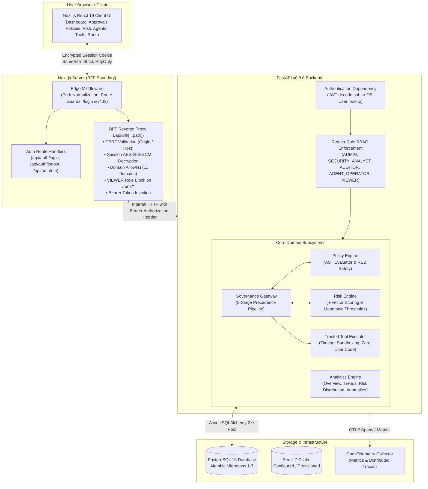
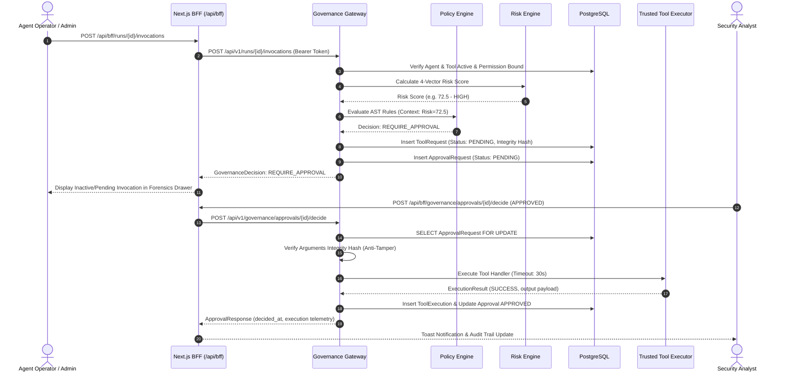
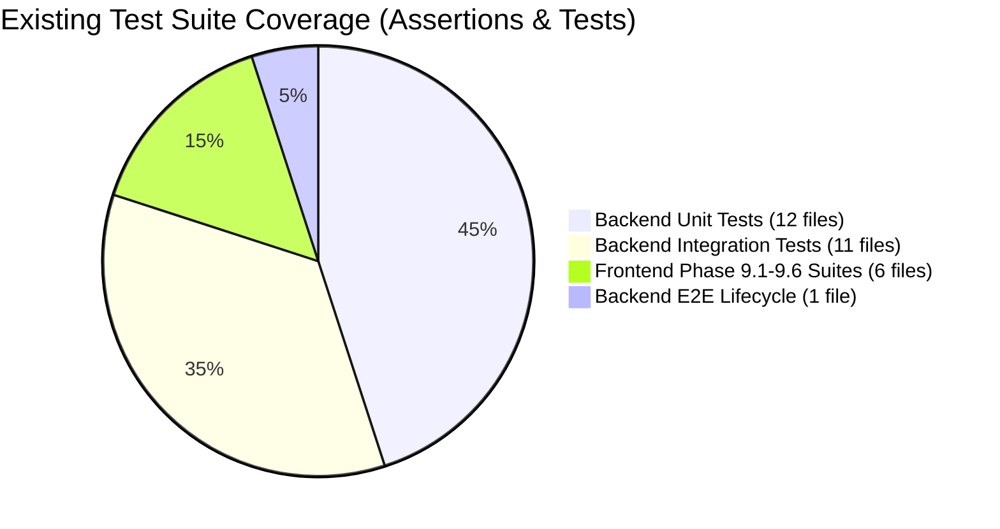
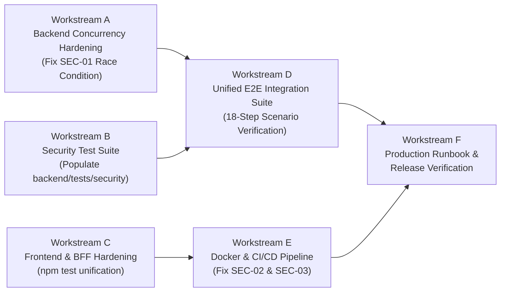
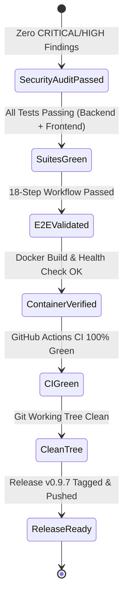

# VERIDEX — Phase 9.7 Final Architecture, Integration Strategy & System-Wide Audit
**Document ID**: `VERIDEX-ARCH-097`  
**Classification**: Internal Architecture Specification & Release Blueprint  
**Status**: DRAFT FOR REVIEW (Phase 9.7 Planning Baseline)  
**Authoritative Starting Baseline**: `v0.9.6` (`5164a4c112ce1c7e0b9b608f5cd340bcf6c80a49`)  
**Target Release**: `v0.9.7` (Production-Ready AI Agent Governance Platform)  

---

## 1. Executive Summary

VERIDEX has successfully completed development through Phase 9.6, implementing a full-stack, enterprise-grade AI Agent Governance & Observability platform. Across nine sequential phases, the platform has assembled:
1. **Core Gateway & Runtime**: FastAPI v0.8.0 backend with asynchronous PostgreSQL, Alembic migrations, OpenTelemetry instrumentation, and a multi-stage trusted tool execution sandbox.
2. **Policy Engine**: AST-based condition evaluation, versioned policy containers, Google RE2 regex ReDoS protection, and dry-run policy simulation.
3. **Multi-Vector Risk Engine**: 4-vector heuristic scoring (Impact, Exposure, Reversibility, Privilege), configurable weights, dynamic monotonic thresholds, empirical risk assessment records, and rolling agent risk profiles.
4. **Governance Gateway & Human-in-the-Loop Review**: 5-stage deterministic evaluation pipeline (`Mandatory Floor` $\rightarrow$ `Risk Deny` $\rightarrow$ `Policy Deny` $\rightarrow$ `Approval Synthesis` $\rightarrow$ `Allow`), cryptographic SHA-256 argument integrity hashing, and transactional approval decisions with row-level locking.
5. **Security Operations Frontend**: Next.js 16.3.7 App Router frontend with AES-256-GCM encrypted session cookies, zero client-side JWT leakage, server-side BFF reverse proxy, 5-role navigation guards, native SVG analytics visualizations, and execution forensics inspection with recursive sensitive data masking.

Phase 9.7 represents the **final consolidation, integration, and release-hardening phase**. Its objective is to audit the entire system, eliminate architectural gaps, eradicate concurrency race conditions, bind end-to-end multi-role workflows into a single executable test harness, validate containerized deployments, and verify release readiness against rigorous security and reliability gates.

---

## 2. Verified Baseline & Environment State

The local repository was audited against origin to establish the immutable baseline for Phase 9.7:

| Property | Audited State | Verification Command / Source |
| :--- | :--- | :--- |
| **Branch** | `main` | `git branch --show-current` $\rightarrow$ `main` |
| **Commit SHA** | `5164a4c112ce1c7e0b9b608f5cd340bcf6c80a49` | `git rev-parse HEAD` |
| **Remote Alignment** | Clean, synchronized with `origin/main` | `git status` $\rightarrow$ `Your branch is up to date with 'origin/main'` |
| **Working Tree** | Clean (`nothing to commit, working tree clean`) | `git status -uno` |
| **Release Tag** | `v0.9.6` (annotated tag `c0e6015b1bd807347d3b43a72884ed65e26786d1`) | `git ls-remote origin "refs/tags/v0.9.6*"` |
| **Backend Runtime** | Python 3.12 / 3.13, FastAPI 0.115.x, SQLAlchemy 2.0.35, asyncpg 0.30+, Pydantic 2.9+, Google RE2 1.1.0 | `backend/pyproject.toml` |
| **Frontend Runtime** | Node.js 22, Next.js 16.3.7, React 19.2.8, Tailwind CSS 4, TypeScript 5, ESLint 9 | `frontend/package.json` |
| **Database** | PostgreSQL 16 Alpine, 7 sequential Alembic migrations (`23da343e58ba` $\rightarrow$ `e59b2f6a9c40`) | `backend/alembic/versions/` |
| **CI System** | GitHub Actions (`.github/workflows/ci.yml`: 4 jobs: backend-test, backend-security, frontend-check, docker-build) | `.github/workflows/ci.yml` |

---

## 3. Current System Architecture



### 3.1 Backend Architectural Review
- **Application Core**: Configured through `pydantic-settings` (`backend/app/common/config.py`). App factory in `backend/app/main.py` attaches structured logging (`structlog`), OpenTelemetry instrumentation, CORS middleware, and mounts `api_v1_router` under prefix `/api/v1`.
- **Authentication & Tenant Isolation**: JWTs encode only user UUID `sub` and expiration `exp`. User status, organization ID, and role are fetched from PostgreSQL upon each authenticated request in `get_current_user` (`backend/app/auth/deps.py`). Organization isolation is enforced at the query level by scoping queries to `current_user.organization_id`.
- **5-Role RBAC Model**:
  1. `ADMIN`: Unrestricted administrative access across all domains, users, policies, tools, and execution runs.
  2. `SECURITY_ANALYST`: Manages tools, policies, and risk configurations; decides pending approvals; reveals sensitive forensic data; inspects analytics.
  3. `AUDITOR`: Read-only compliance inspection across approvals, policies, risk assessments, forensic runs, analytics, and users; cannot mutate resources or reveal sensitive payloads.
  4. `AGENT_OPERATOR`: Registers and maintains agents; initiates runs; dispatches tool invocations; simulates policies and risk; views approval queue.
  5. `VIEWER`: Read-only access restricted strictly to agent roster, tool catalog, policies, and risk configurations. Strictly prohibited from `/runs/*`, dashboard analytics, and organization settings.
- **Governance Gateway Precedence**: Evaluates requests in 5 strict stages:
  1. *Stage 1 (Mandatory Platform Floor)*: Missing agent-tool permission binding or inactive entity status immediately yields `DENY`.
  2. *Stage 2 (Risk Denial)*: Empirical risk score $\ge \text{deny\_threshold}$ immediately yields `DENY`.
  3. *Stage 3 (Policy Denial)*: Active policy evaluating to `DENY` is absolute.
  4. *Stage 4 (Approval Synthesis)*: Policy `REQUIRE_APPROVAL` or risk score $\ge \text{approval\_threshold}$ or baseline risk rules (e.g. `CRITICAL` risk level, `IRREVERSIBLE WRITE`, `RESTRICTED` data) generates a persistent `ApprovalRequest` in `PENDING` state and yields `REQUIRE_APPROVAL`.
  5. *Stage 5 (Clean Execution)*: When all checks pass, executes the trusted tool handler within timeout boundaries and persists execution telemetry.
- **Concurrency & Replay Defense**:
  - `ApprovalRequest` processing utilizes `SELECT ... FOR UPDATE` row-level locks.
  - Arguments SHA-256 hash `compute_arguments_hash(tool_version_id, arguments)` is verified during evaluation, stored on approval records, and re-computed during execution to eliminate time-of-check/time-of-use (TOCTOU) argument tampering.
  - Idempotency key uniqueness index on `ToolRequest` prevents duplicate execution replays.

### 3.2 Frontend Architectural Review
- **BFF Reverse Proxy (`frontend/src/app/api/bff/[...path]/route.ts`)**: Bridges browser clients to the backend without leaking tokens. Validates CSRF headers on mutating methods, verifies top-level domain against an explicit allowlist (11 domains), enforces normalization against traversal attacks, strips untrusted client headers, decrypts the session cookie, injects `Authorization: Bearer <token>`, and handles 401 token invalidation.
- **Client State & Mutation Hooks**: Custom React hooks (`useAgents`, `useTools`, `useRuns`) provide centralized state management, filtering, pagination, and optimistic updates.
- **Sensitive Data Scrubbing**:
  - `maskSensitiveData`: Recursive object and array sanitizer that masks known sensitive keys (`password`, `token`, `secret`, `api_key`, `credential`, `card_number`) and high-entropy patterns (JWT, OpenAI, GitHub PAT, AWS keys).
  - `canRevealSensitiveData`: Limits reveal toggles to `ADMIN` and `SECURITY_ANALYST` roles.
  - State reset on drawer close: Plaintext reveal state strictly resets when drawer closes or invocation changes.
  - `sanitizeExecutionError`: Scrubs internal filesystem paths (Windows and POSIX), database connection strings with passwords, and JWT tokens before rendering exceptions.

---

## 4. Backend/Frontend Integration Map

| Frontend UI View | BFF Route | FastAPI v0.8.0 Endpoint | Allowed Roles | Functional Capabilities |
| :--- | :--- | :--- | :--- | :--- |
| **Login** (`/login`) | `/api/auth/login` | `POST /api/v1/auth/login` | Public | Authenticates credentials, creates encrypted AES-256-GCM session cookie. |
| **Logout** (User Dropdown) | `/api/auth/logout` | N/A (Server-side) | Authenticated | Clears `veridex_session` cookie and invalidates client session. |
| **User Identity** | `/api/auth/me` | `GET /api/v1/auth/me` | Authenticated | Returns current authenticated user and organization metadata. |
| **Dashboard** (`/dashboard`) | `/api/bff/analytics/overview`<br/>`/api/bff/analytics/trends`<br/>`/api/bff/analytics/risk-distribution`<br/>`/api/bff/analytics/anomalies` | `GET /api/v1/analytics/overview`<br/>`GET /api/v1/analytics/trends`<br/>`GET /api/v1/analytics/risk-distribution`<br/>`GET /api/v1/analytics/anomalies` | `ADMIN`<br/>`SECURITY_ANALYST`<br/>`AUDITOR` | Visualizes governance volume, decision breakdown, latency distribution, time-series metrics, and policy anomaly alerts. |
| **Approvals Queue** (`/approvals`) | `/api/bff/governance/approvals`<br/>`/api/bff/governance/approvals/{id}`<br/>`/api/bff/governance/approvals/{id}/decide` | `GET /api/v1/governance/approvals`<br/>`GET /api/v1/governance/approvals/{id}`<br/>`POST /api/v1/governance/approvals/{id}/decide` | View: 4 roles (excl. VIEWER)<br/>Decide: `ADMIN`, `SECURITY_ANALYST` | Inspects pending human-in-the-loop approval requests, evaluates risk factors, submits approval or rejection with mandatory rationale. |
| **Agent Registry** (`/agents`) | `/api/bff/agents`<br/>`/api/bff/agents/{id}`<br/>`/api/bff/agents/{id}/versions`<br/>`/api/bff/agents/{id}/tools` | `GET, POST /api/v1/agents`<br/>`GET, PATCH /api/v1/agents/{id}`<br/>`GET, POST /api/v1/agents/{id}/versions`<br/>`GET, POST, DELETE /api/v1/agents/{id}/tools` | Read: All 5 roles<br/>Mutate: `ADMIN`, `AGENT_OPERATOR` | Registers agents, freezes version snapshots, manages agent lifecycle status, binds/unbinds tool permission grants. |
| **Tool Catalog** (`/tools`) | `/api/bff/tools`<br/>`/api/bff/tools/{id}`<br/>`/api/bff/tools/{id}/versions`<br/>`/api/bff/tools/{id}/versions/{vid}/publish` | `GET, POST /api/v1/tools`<br/>`GET, PATCH /api/v1/tools/{id}`<br/>`GET, POST /api/v1/tools/{id}/versions`<br/>`POST /api/v1/tools/{id}/versions/{vid}/publish` | Read: All 5 roles<br/>Mutate: `ADMIN`, `SECURITY_ANALYST` | Registers tools, manages JSON input/output schemas, defines data classification & risk level, publishes DRAFT versions to PUBLISHED. |
| **Policy Workbench** (`/policies`) | `/api/bff/policies`<br/>`/api/bff/policies/{id}`<br/>`/api/bff/policies/{id}/versions`<br/>`/api/bff/policies/{id}/rules`<br/>`/api/bff/policies/simulate` | `GET, POST /api/v1/policies`<br/>`GET, PATCH /api/v1/policies/{id}`<br/>`GET, POST /api/v1/policies/{id}/versions`<br/>`POST, PATCH, DELETE /api/v1/policies/{id}/rules`<br/>`POST /api/v1/policies/simulate` | Read: All 5 roles<br/>Mutate: `ADMIN`, `SECURITY_ANALYST`<br/>Simulate: 4 roles | Authoring policies, building AST condition trees, visual structural diffs, policy simulation without persistence. |
| **Risk Workbench** (`/risk`) | `/api/bff/risk/config`<br/>`/api/bff/risk/config/versions`<br/>`/api/bff/risk/assessments`<br/>`/api/bff/risk/evaluate` | `GET /api/v1/risk/config`<br/>`POST /api/v1/risk/config/versions`<br/>`GET /api/v1/risk/assessments`<br/>`POST /api/v1/risk/evaluate` | Read: All 5 roles<br/>Mutate: `ADMIN`, `SECURITY_ANALYST`<br/>Simulate: All 5 roles | Configures 4-vector weights and monotonic thresholds, inspects historical assessments, executes dry-run risk simulations. |
| **Agent Runs & Forensics** (`/runs`, `/runs/[runId]`) | `/api/bff/runs`<br/>`/api/bff/runs/{id}`<br/>`/api/bff/runs/{id}/status`<br/>`/api/bff/runs/{id}/invocations` | `GET, POST /api/v1/runs`<br/>`GET /api/v1/runs/{id}`<br/>`PATCH /api/v1/runs/{id}/status`<br/>`GET, POST /api/v1/runs/{id}/invocations` | Read: 4 roles (VIEWER 403 Forbidden)<br/>Mutate: `ADMIN`, `AGENT_OPERATOR`<br/>Reveal: `ADMIN`, `SECURITY_ANALYST` | Lists execution sessions, displays chronological invocation timeline, inspects masked arguments/results, reveals plaintext for authorized analysts, renders sanitized errors. |
| **Organization Settings** (`/organization`) | `/api/bff/organizations/my`<br/>`/api/bff/users` | `GET /api/v1/organizations/my`<br/>`GET /api/v1/users` | `ADMIN`<br/>`SECURITY_ANALYST`<br/>`AUDITOR` | Views organization slug, membership roster, role distribution, and audit overview. |

---

## 5. End-to-End Workflow Verification Matrix (18 Core Scenarios)



### Detailed Workflow Analysis Matrix

| # | Scenario | Starting Conditions | Endpoints Involved | Backend Behavior | Frontend Behavior | DB Mutations | Security Assertions | Test Status |
| :--- | :--- | :--- | :--- | :--- | :--- | :--- | :--- | :--- |
| **1** | **User Login & Session** | Active user in DB; valid credentials. | `POST /api/auth/login`<br/>$\rightarrow$ `POST /api/v1/auth/login` | Verifies bcrypt password hash; generates signed JWT. | Stores AES-256-GCM encrypted cookie; redirects to role landing. | Updates `users.last_login_at`. | Zero JWT leakage to client storage or JavaScript scope. | **Covered** (`test-phase-9-1.mjs`, `test_api_auth.py`) |
| **2** | **Tenant Isolation** | Two orgs in DB (`Org A`, `Org B`). | All `/api/v1/*` endpoints. | Queries filtered strictly by `current_user.organization_id`. | UI shows only tenant assets; rejects cross-tenant URL IDs. | Cross-org read/write rejected (404/403). | Zero cross-tenant data leakage even with guessable UUIDs. | **Partial** (`test_governance_risk_integration.py`, needs universal check) |
| **3** | **Agent Lifecycle** | Authenticated as `ADMIN` or `AGENT_OPERATOR`. | `POST /api/v1/agents`<br/>`POST /api/v1/agents/{id}/versions`<br/>`POST /api/v1/agents/{id}/status` | Creates container; snaps immutable DRAFT version; updates status. | Form validation; modal workflows; updates roster table. | Inserts `agents`, `agent_versions`; updates `agents.status`. | Version snapshots are immutable; `AUDITOR`/`VIEWER` cannot mutate. | **Covered** (`test-phase-9-6.mjs`, `test_api_agents.py`) |
| **4** | **Tool Publication** | Authenticated as `ADMIN` or `SECURITY_ANALYST`. | `POST /api/v1/tools`<br/>`POST /api/v1/tools/{id}/versions`<br/>`POST /api/v1/tools/{id}/versions/{vid}/publish` | Validates JSON schemas; transitions version DRAFT $\rightarrow$ PUBLISHED. | JSON schema editor; publication confirmation dialog. | Inserts `tools`, `tool_versions`; updates `tool_versions.status`. | Once `PUBLISHED`, schema and configuration are permanently immutable. | **Covered** (`test-phase-9-6.mjs`, `test_tools.py`) |
| **5** | **Permission Binding** | Active Agent and Tool exist in same Org. | `POST /api/v1/agents/{id}/tools/{tid}`<br/>`DELETE /api/v1/agents/{id}/tools/{tid}` | Creates/deletes permission link; validates environment. | Tool binding dialog; displays grant list in drawer. | Inserts/deletes `agent_tool_permissions`. | Cross-tenant binding rejected; requires operator/admin role. | **Covered** (`test-phase-9-6.mjs`, `test_api_agents.py`) |
| **6** | **Policy Configuration** | Authenticated as `ADMIN` or `SECURITY_ANALYST`. | `POST /api/v1/policies`<br/>`POST /api/v1/policies/{id}/rules`<br/>`POST /api/v1/policies/{id}/versions` | Validates AST depth ($\le 5$), leaves ($\le 20$), RE2 regex safety. | Interactive AST rule builder; condition preview; diff engine. | Inserts `policies`, `policy_rules`, `policy_versions`. | ReDoS-vulnerable regexes rejected at submission time. | **Covered** (`test-phase-9-5.mjs`, `test_policy_api.py`) |
| **7** | **Policy Evaluation** | AgentRun active; Tool invocation dispatched. | `POST /api/v1/runs/{id}/invocations`<br/>or `POST /api/v1/governance/evaluate` | Evaluates active policies in priority order; evaluates condition ASTs. | Displays decision badge, violation codes, and matched rules. | Dry-run: 0 mutations; Live: persists in `tool_requests`. | Deterministic evaluation; DENY action always takes precedence. | **Covered** (`test_policy_evaluator.py`, `test_governance_service.py`) |
| **8** | **Risk Assessment** | Tool invocation evaluated. | Integrated in Gateway or `POST /api/v1/risk/evaluate` | Calculates 4-vector heuristic score; applies weights; maps level. | Renders 4 vector progress bars; displays risk score & badge. | Persists `risk_assessments`; updates `agent_risk_profiles`. | Risk score bounded $[0, 100]$; thresholds strictly monotonic. | **Covered** (`test-phase-9-5.mjs`, `test_risk_service.py`) |
| **9** | **Governance Verdict** | Full 5-stage pipeline executed. | `POST /api/v1/runs/{id}/invocations` | Resolves precedence: Floor $\rightarrow$ Risk Deny $\rightarrow$ Policy Deny $\rightarrow$ Approval $\rightarrow$ Allow. | Color-coded verdict badge; policy violation tags; reasons list. | Writes `tool_requests.decision` and violation codes. | Precedence ordering mathematically invariant. | **Covered** (`test_governance_performance.py`, `test-phase-9-4.mjs`) |
| **10** | **Approval Creation** | Invocation requires human review. | `POST /api/v1/runs/{id}/invocations`<br/>$\rightarrow$ `GET /api/v1/governance/approvals` | Generates `ApprovalRequest(status=PENDING)`; links to `ToolRequest`. | Invocation shown with pending review badge; visible in `/approvals`. | Inserts `approval_requests`; sets `tool_requests.decision=REQUIRE_APPROVAL`. | Arguments SHA-256 hash locked at creation time. | **Covered** (`test-phase-9-4.mjs`, `test_governance_api.py`) |
| **11** | **Approval Decision** | `ADMIN` or `SECURITY_ANALYST` reviews request. | `POST /api/v1/governance/approvals/{id}/decide` | Locks row (`FOR UPDATE`); checks hash; re-checks status; executes tool. | Decision dialog; mandatory 5-char reason; updates UI queue. | Updates `approval_requests.status`; creates `tool_executions`. | Concurrency lock prevents replay; argument tampering rejected. | **Covered** (`test-phase-9-4.mjs`, `test_governance_api.py`) |
| **12** | **Tool Execution** | Decision is `ALLOW` or `APPROVED`. | Subsystem in `ToolExecutor`. | Dispatches to registered handler within timeout; catches all errors. | Renders execution output JSON; duration in ms; status badge. | Inserts `tool_executions` record with result/error/duration. | Never executes arbitrary shell/eval; timeout halts runaway jobs. | **Covered** (`test-phase-9-6.mjs`, `test_governance_service.py`) |
| **13** | **Run Status Lifecycle** | AgentRun in progress. | `PATCH /api/v1/runs/{id}/status` | Updates `AgentRun.status` (`ACTIVE`, `PAUSED`, `COMPLETED`, `FAILED`). | Status update modal; timeline banner; header badges. | Updates `agent_runs.status`, `ended_at`, `output_summary`. | Only operator/admin can update; invalid state transitions rejected. | **Covered** (`test-phase-9-6.mjs`, `test_governance_api.py`) |
| **14** | **Execution Forensics** | Completed or active Run inspected. | `GET /api/v1/runs/{id}`<br/>`GET /api/v1/runs/{id}/invocations` | Returns chronological invocation list with execution results & errors. | Timeline view; drawer inspector; sanitized error callout. | Read-only. | VIEWER receives 403; internal paths & database URIs scrubbed. | **Covered** (`test-phase-9-6.mjs`, `test-phase-9-6-remediation`) |
| **15** | **Analytics Consistency** | Governance decisions recorded. | `GET /api/v1/analytics/*` | Aggregates SQL group-bys over `tool_requests` and `approval_requests`. | Dashboard charts; metrics grid; zero-division safe SVG geometry. | Read-only. | Overview counts match underlying historical rows exactly. | **Covered** (`test-phase-9-3.mjs`, `test_analytics_api.py`) |
| **16** | **Unauthorized Access** | Low-privilege role visits restricted route. | Edge middleware + BFF proxy + FastAPI endpoints | Server-side 403 Forbidden; redirects browser to `/403`. | Displays hardened access-denied page with return button. | Read-only (logs 403 event). | Defense in depth: edge, BFF proxy, and FastAPI all reject request. | **Covered** (`test-phase-9-2.mjs`, `test-phase-9-6.mjs`) |
| **17** | **Sensitive Redaction** | Payloads contain keys, tokens, or credentials. | Forensics drawer; approvals detail. | Raw payloads stored in DB (encrypted in transit); sanitized in logs. | Recursive masking applied prior to render; authorized reveal toggle. | Read-only. | Unmasked secrets never appear in DOM unless explicitly revealed. | **Covered** (`test-phase-9-4.mjs`, `test-phase-9-6.mjs`) |
| **18** | **Session Expiry & Logout** | Session exceeds 30m or token invalid. | `GET /api/bff/*`<br/>`POST /api/auth/logout` | Decryption failure or FastAPI 401 triggers cookie deletion. | Purges cookie; redirects to `/login?next=...`. | Nullifies cookie on client response. | Expired sessions cannot be extended; old cookies immediately voided. | **Covered** (`test-phase-9-1.mjs`, `test-phase-9-2.mjs`) |

---

## 6. Comprehensive Security Audit & Vulnerability Assessment

### 6.1 Vulnerability Severity Breakdown
- **CRITICAL**: 0 findings
- **HIGH**: 1 finding (Concurrency / Shared Mutable State in Async Service)
- **MEDIUM**: 3 findings (Docker Container Networking, Incomplete CI Test Suite, Empty Security Test Directory)
- **LOW**: 2 findings (Debug Mode Exposure in Development Compose, Missing Backend Rate Limiting)
- **INFORMATIONAL**: 2 findings (Unused Redis Infrastructure, Next.js Middleware Deprecation Warning)

---

### 6.2 Detailed Findings Registry

#### Finding SEC-01 (HIGH): Concurrency Race Condition via Shared Mutable State in Singleton Service
- **Affected Module**: `backend/app/governance/service.py` (`GovernanceService._evaluate_policy`, lines 78–79, 449, 488, 502, 658–659)
- **Evidence**:
  ```python
  # GovernanceService.__init__
  self._last_policy_evaluations: dict[str, Any] = {}
  self._last_risk_evaluation: RiskEvaluationResult | None = None
  
  # GovernanceService._evaluate_policy (called concurrently across async requests)
  self._last_policy_evaluations = {**trace_data, "decision": "ALLOW"}
  
  # GovernanceService.invoke_tool (after await _evaluate_policy)
  policy_trace = self._last_policy_evaluations
  risk_eval = self._last_risk_evaluation
  ```
- **Impact & Exploitability**: In an asynchronous event loop handling concurrent tool invocations (from different agents, users, or even different organizations), `_evaluate_policy` contains an `await` point (`await policy_service.evaluate_policies`). During that yield, an interleaving request executes and overwrites `self._last_policy_evaluations` and `self._last_risk_evaluation`. When the first request resumes, it attaches the *second* request's policy trace and risk evaluation to its telemetry span and database records. This causes cross-request telemetry contamination and potential audit record corruption.
- **Remediation**: Remove `self._last_policy_evaluations` and `self._last_risk_evaluation` from the instance state. Have `_evaluate_policy` return `(decision, violation_codes, reason, tool, tool_version, trace_data, risk_eval)` directly as a typed tuple or dataclass.
- **Required Regression Test**: Concurrent evaluation test launching 20 simultaneous invocations with distinct arguments and asserting that each invocation's returned trace matches its own input exactly.

---

#### Finding SEC-02 (MEDIUM): Broken Server-Side BFF Connectivity in Docker Compose
- **Affected Module**: `docker-compose.yml` (frontend service environment, line 90) and `frontend/src/lib/bff-client.ts` (lines 13–18)
- **Evidence**:
  ```yaml
  # docker-compose.yml
  frontend:
    environment:
      NEXT_PUBLIC_API_URL: "http://localhost:8000"
  ```
  ```typescript
  // frontend/src/lib/bff-client.ts
  export function getFastApiBaseUrl(): string {
    return (
      process.env.FASTAPI_BACKEND_URL ||
      process.env.NEXT_PUBLIC_API_URL ||
      "http://localhost:8000"
    ).replace(/\/+$/, "");
  }
  ```
- **Impact & Exploitability**: When deployed via `docker compose up`, the frontend container runs Node.js server-side route handlers (`/api/bff/*`). Because `FASTAPI_BACKEND_URL` is omitted, the BFF client defaults to `NEXT_PUBLIC_API_URL` (`http://localhost:8000`). Inside the frontend container, `localhost:8000` refers to the *frontend container itself*, where nothing is listening on port 8000. All server-side BFF requests fail with `ECONNREFUSED`. The backend is only reachable across the Docker network at `http://backend:8000`.
- **Remediation**: In `docker-compose.yml`, supply `FASTAPI_BACKEND_URL: "http://backend:8000"` in the frontend service environment block while retaining `NEXT_PUBLIC_API_URL: "http://localhost:8000"` for browser-direct references.
- **Required Regression Test**: Docker compose integration smoke test asserting `GET /api/bff/health` from the frontend container returns HTTP 200 with backend health status.

---

#### Finding SEC-03 (MEDIUM): CI Pipeline Omission of Phase Test Suites and npm test
- **Affected Module**: `.github/workflows/ci.yml` (lines 116–143) and `frontend/package.json` (line 10)
- **Evidence**:
  ```yaml
  # .github/workflows/ci.yml
  - name: Lint
    run: npm run lint
  - name: Type check
    run: npx tsc --noEmit
  - name: Build
    run: npm run build
  ```
  ```json
  // frontend/package.json
  "test": "node test-phase-9-1.mjs && node test-route-handlers.mjs && node test-phase-9-2.mjs && node test-phase-9-3.mjs && node test-phase-9-4.mjs && node test-phase-9-5.mjs"
  ```
- **Impact & Exploitability**:
  1. The GitHub Actions CI `frontend-check` job never runs `npm test`. Any breaking changes to route handlers, session encryption, RBAC navigation, or redaction formatters will not fail CI on PRs.
  2. `frontend/package.json`'s `test` script omits `test-phase-9-6.mjs`. Running `npm test` locally skips the entire Agent/Tool/Forensics verification suite.
- **Remediation**: Update `frontend/package.json` to include `test-phase-9-6.mjs` (and upcoming Phase 9.7 verification), and add `npm test` step to `.github/workflows/ci.yml`.
- **Required Regression Test**: Verify GitHub Actions workflow locally or in CI run and ensure test step passes.

---

#### Finding SEC-04 (MEDIUM): Empty Backend Security Test Suite
- **Affected Module**: `backend/tests/security/__init__.py`
- **Evidence**: `backend/tests/security/` directory contains only an empty `__init__.py` (0 test files).
- **Impact & Exploitability**: While basic tenant isolation is tested in `test_governance_risk_integration.py`, there is no dedicated security regression suite verifying SQL injection immunity in query filters, cross-organization UUID tampering, CSRF token forgery, or privilege escalation across all API endpoints.
- **Remediation**: Populate `backend/tests/security/` with dedicated automated tests verifying:
  1. Cross-tenant rejection across all endpoints.
  2. SQL injection safety in analytics string filters and sorting params.
  3. Strict 403 Forbidden enforcement on role boundary violations.
- **Required Regression Test**: New `backend/tests/security/test_rbac_and_tenant_isolation.py` test module passing 100%.

---

#### Finding SEC-05 (LOW): Development Secret Key and Debug Mode in Compose Configuration
- **Affected Module**: `docker-compose.yml` (lines 62–63)
- **Evidence**:
  ```yaml
  VERIDEX_DEBUG: "true"
  VERIDEX_SECRET_KEY: "dev-secret-key-change-in-production"
  ```
- **Impact & Exploitability**: When `VERIDEX_DEBUG: "true"` is active, FastAPI prints interactive stack traces on unhandled 500 exceptions, exposing internal filesystem paths and code snippets. If a user deploys `docker-compose.yml` directly to a production server without overriding environment variables, secrets and stack traces could be exposed.
- **Remediation**: In `docker-compose.yml`, document that `.env.production` is required for production deployments. In `backend/app/main.py`, enforce a startup validation check that prevents starting with `environment="production"` when `debug=True` or `secret_key="dev-secret-key-change-in-production"`.
- **Required Regression Test**: Unit test verifying `create_app()` raises `RuntimeError` if production environment has default secret key.

---

#### Finding SEC-06 (LOW): Absence of Application-Layer Rate Limiting
- **Affected Module**: `backend/app/main.py` and `backend/app/api/v1/auth.py`
- **Evidence**: No rate limiting middleware or route decorators exist anywhere in the backend application.
- **Impact & Exploitability**: Endpoints like `POST /api/v1/auth/login` (brute force credential attacks) and `POST /api/v1/policies/simulate` or `POST /api/v1/risk/evaluate` (CPU-intensive AST and regex evaluation) are susceptible to volumetric denial-of-service or credential stuffing if deployed without an upstream reverse proxy rate limiter.
- **Remediation**: In Phase 9.7, document recommended NGINX / Cloudflare rate-limiting rules in the production deployment guide, or integrate a simple in-memory or Redis-backed rate limiter on sensitive endpoints.
- **Required Regression Test**: Rate limit configuration test verifying burst limits on `/auth/login`.

---

#### Finding SEC-07 (INFORMATIONAL): Unutilized Redis Infrastructure
- **Affected Module**: `docker-compose.yml` (service `redis`) and `backend/app/common/config.py` (`redis_url`)
- **Evidence**: Redis is provisioned and healthchecked in Docker and CI, but zero application code imports or interacts with Redis.
- **Impact & Exploitability**: Consumes memory and operational overhead without providing functionality.
- **Remediation**: Clarify whether Redis is reserved for future distributed caching/rate-limiting or should be removed from the default development stack.

---

#### Finding SEC-08 (INFORMATIONAL): Next.js Middleware File Convention Deprecation
- **Affected Module**: `frontend/src/middleware.ts`
- **Evidence**: Next.js 16.3.7 build logs: `The "middleware" file convention is deprecated. Please use "proxy" instead.`
- **Impact & Exploitability**: Zero security impact currently; Next.js fully supports `middleware.ts`. Future major framework updates may require renaming or restructuring.
- **Remediation**: Plan migration to the `proxy` convention in future roadmap after Next.js finalizes the specification.

---

## 7. Test Strategy & CI Quality Review

### 7.1 Existing Test Suite Inventory



1. **Backend Unit Suites** (`backend/tests/unit/`):
   - `test_policy_evaluator.py`, `test_policy_models.py`: AST depth, leaf bounds, RE2 regex safety, priority ordering.
   - `test_risk_service.py`, `test_risk_models.py`: 4-vector heuristic scoring, weight normalization, monotonic thresholds.
   - `test_governance_service.py`, `test_governance_models.py`, `test_governance_performance.py`: 5-stage pipeline, concurrency, decision latency.
   - `test_analytics_service.py`: UTC half-open intervals, volume queries, latency metrics.
   - `test_auth.py`, `test_health.py`, `test_telemetry.py`: Password hashing, token encoding, healthchecks, OTel spans.
2. **Backend Integration Suites** (`backend/tests/integration/`):
   - `test_api_auth.py`, `test_api_users.py`: Authentication lifecycle, user retrieval.
   - `test_api_agents.py`, `test_tools.py`: Agent/tool CRUD, versioning, permission grants.
   - `test_policy_api.py`, `test_risk_api.py`: Policy and risk endpoint contracts.
   - `test_governance_api.py`, `test_governance_risk_integration.py`: Live runs, invocations, approval decisions.
   - `test_analytics_api.py`: Analytics REST endpoints, granularity constraints.
3. **Backend E2E Suite** (`backend/tests/e2e/`):
   - `test_risk_governance_lifecycle.py`: 450-line end-to-end integration covering multi-role registration, risk publication, policy creation, approval decisions, and agent profile update.
4. **Frontend Verification Suites** (`frontend/test-phase-9-*.mjs`):
   - `test-phase-9-1.mjs`: AES-256-GCM session encryption, 30m expiration, CSRF origin verification, BFF domain allowlist.
   - `test-phase-9-2.mjs`: Five-role navigation visibility, route access control, redirect loop immunity (18 permutations).
   - `test-phase-9-3.mjs`: Analytics contracts, tenant isolation, UTC intervals, native SVG math resilience.
   - `test-phase-9-4.mjs`: Approvals queue contracts, status lifecycle, mandatory audit rationale, recursive argument masking.
   - `test-phase-9-5.mjs`: Policy AST validator, structural diff engine, 4-vector risk model, weights & thresholds.
   - `test-phase-9-6.mjs`: Execution error sanitization (paths, URIs, API keys, JWTs), recursive redaction, drawer state reset, 5-role forensics RBAC.

### 7.2 Critical Test Gaps
1. **No True Browser E2E Test**: All frontend tests currently run as Node.js contract simulations. There are no automated browser tests (e.g. Playwright or Puppeteer) verifying full DOM interactions, modal toggles, and live page transitions against a running Next.js server.
2. **Missing CI Invocation of Frontend Phase Suites**: `.github/workflows/ci.yml` builds the frontend and runs lint, but never runs `npm test`.
3. **Missing Dedicated Security Regression Module**: `backend/tests/security/` has no test files.
4. **Incomplete Cross-Service E2E Test**: No single test runs from Next.js BFF $\rightarrow$ FastAPI $\rightarrow$ PostgreSQL $\rightarrow$ ToolExecutor $\rightarrow$ Analytics verification in a unified containerized setup.

---

## 8. Production Readiness Assessment

| Operational Dimension | Status | Assessment & Evidence | Remediation for Phase 9.7 |
| :--- | :--- | :--- | :--- |
| **Secrets Management** | **ACCEPTABLE** | Passwords hashed with bcrypt; sessions encrypted with AES-256-GCM; JWT secrets loaded from environment variables (`VERIDEX_SECRET_KEY`, `SESSION_SECRET`). | Add startup assertion in `main.py` failing if default insecure secrets are used in production. |
| **Database Migrations** | **READY** | 7 clean sequential Alembic migrations with explicit upgrade and downgrade paths; indexed foreign keys and composite governance indexes. | Run end-to-end migration validation (`alembic upgrade head` $\rightarrow$ `downgrade base` $\rightarrow$ `upgrade head`). |
| **Health & Readiness** | **READY** | `/api/v1/health` (process health) and `/api/v1/ready` (live PostgreSQL `SELECT 1` connectivity check) implemented. Docker HEALTHCHECK directives configured. | Verify readiness endpoint returns 503 if database connection drops. |
| **Observability & Logging** | **READY** | Structured JSON logging via `structlog`; OpenTelemetry tracing instrumenting FastAPI, SQLAlchemy, HTTPX, and Governance Gateway. | Validate OpenTelemetry Collector endpoint configuration in Docker compose. |
| **Container Security** | **READY** | Multi-stage Dockerfiles (`python:3.13-slim`, `node:22-slim`); non-root user execution (`USER veridex`); minimal runtime attack surface. | Fix container networking environment variable (`FASTAPI_BACKEND_URL`). |
| **Graceful Shutdown** | **READY** | FastAPI lifespan handler flushes OTel tracer providers and closes database connection pools cleanly on SIGTERM/SIGINT. | Retain existing shutdown handler. |
| **Tenant Isolation** | **READY** | Strict token-to-user database resolution; organization ID derived exclusively from verified user record; explicit tenant query filtering. | Add dedicated multi-tenant boundary test in `backend/tests/security/`. |
| **Error Safety** | **ACCEPTABLE** | Forensic drawer sanitizes paths, DB URIs, and JWTs; frontend hides internal details. In production (`debug=False`), FastAPI returns generic 500 details. | Register global FastAPI exception handler ensuring zero traceback leaks even under misconfiguration. |

---

## 9. Proposed Phase 9.7 Implementation Architecture

Phase 9.7 is structured into six focused, non-disruptive workstreams:



### Workstream A: Backend Concurrency & Reliability Hardening
- **Objective**: Fix Finding SEC-01 (shared mutable state on singleton `GovernanceService`).
- **Files Affected**: `backend/app/governance/service.py`.
- **Changes**:
  - Refactor `_evaluate_policy` to return a typed dataclass:
    ```python
    @dataclass
    class GovernanceEvaluationOutcome:
        decision: GovernanceDecision
        violation_codes: list[GovernanceViolationCode | str]
        reason: str
        tool: Tool | None
        tool_version: ToolVersion | None
        trace_data: dict[str, Any]
        risk_evaluation: RiskEvaluationResult | None
    ```
  - Eliminate `self._last_policy_evaluations` and `self._last_risk_evaluation`. Pass evaluation outcomes directly via local stack variables.
  - Register a production exception handler in `backend/app/main.py` ensuring unhandled exceptions always return sanitized JSON error envelopes without tracebacks.
- **Acceptance Criteria**: Concurrent execution test with 20 parallel async requests confirms zero trace or risk evaluation leakage across requests.

### Workstream B: Dedicated Backend Security Test Suite
- **Objective**: Remediate Finding SEC-04 by populating `backend/tests/security/`.
- **Files Affected**:
  - `backend/tests/security/test_tenant_isolation.py`
  - `backend/tests/security/test_rbac_boundaries.py`
  - `backend/tests/security/test_input_sanitization.py`
- **Changes**: Add automated tests asserting that:
  - User from Org A cannot read or modify agents, tools, policies, risk configs, runs, or approvals belonging to Org B.
  - Roles cannot execute unpermitted actions (e.g., `VIEWER` calling `/runs`, `AUDITOR` deciding approvals, `AGENT_OPERATOR` modifying policies).
  - Malicious SQL, path traversal characters, and oversized payloads are safely rejected.
- **Acceptance Criteria**: All security tests pass with 100% green status.

### Workstream C: Frontend Package Scripts & Test Unification
- **Objective**: Remediate Finding SEC-03 (frontend test coverage in package scripts).
- **Files Affected**:
  - `frontend/package.json`
  - `frontend/test-phase-9-7.mjs` (Phase 9.7 verification harness)
- **Changes**:
  - Update `"test"` script in `frontend/package.json`:
    ```json
    "test": "node test-phase-9-1.mjs && node test-phase-9-2.mjs && node test-phase-9-3.mjs && node test-phase-9-4.mjs && node test-phase-9-5.mjs && node test-phase-9-6.mjs && node test-phase-9-7.mjs"
    ```
  - Create `frontend/test-phase-9-7.mjs` verifying complete end-to-end system integration, concurrency immunity, and production configuration boundaries.
- **Acceptance Criteria**: Running `npm test` executes all test suites sequentially and exits with code 0.

### Workstream D: Unified End-to-End Test Suite (18-Workflow Verification)
- **Objective**: Validate all 18 core governance scenarios from Section 5 in an automated integration test.
- **Files Affected**: `backend/tests/e2e/test_system_wide_integration.py`.
- **Changes**: Implement an end-to-end integration test exercising the complete chain:
  1. Login as Admin, Operator, Analyst, Auditor, and Viewer.
  2. Create Agent and Tool in Org A and Org B (assert tenant isolation).
  3. Publish Tool Version to PUBLISHED.
  4. Bind Tool Permission to Agent.
  5. Configure Policy with AST rules.
  6. Publish Risk Configuration Version with monotonic thresholds.
  7. Start AgentRun.
  8. Dispatch Tool Invocations triggering:
     - Immediate DENY (missing permission).
     - REQUIRE_APPROVAL (policy and risk triggers).
     - Clean ALLOW (valid invocation executing in sandbox).
  9. Inspect Approvals Queue and decide pending approval with rationale.
  10. Verify persistent execution outcome and arguments hash integrity.
  11. Complete AgentRun.
  12. Verify Overview, Trends, and Risk Distribution Analytics match recorded counts.
- **Acceptance Criteria**: Test passes without mocking internal business logic.

### Workstream E: Docker Compose & CI/CD Pipeline Hardening
- **Objective**: Remediate Finding SEC-02 and SEC-03 in deployment infrastructure.
- **Files Affected**:
  - `docker-compose.yml`
  - `.github/workflows/ci.yml`
- **Changes**:
  - In `docker-compose.yml`, configure `FASTAPI_BACKEND_URL: "http://backend:8000"` in the frontend environment block.
  - In `.github/workflows/ci.yml`, add `npm test` to the `frontend-check` job:
    ```yaml
    - name: Run frontend test suites
      working-directory: frontend
      run: npm test
    ```
  - Add security test execution to `backend-test` job.
- **Acceptance Criteria**: Both frontend and backend Docker containers build cleanly; CI workflow validates all unit, integration, and frontend suites.

### Workstream F: Release Verification, Operational Runbook & Final Acceptance
- **Objective**: Prepare comprehensive production operational documentation and release artifacts for `v0.9.7`.
- **Files Affected**:
  - `README.md`
  - `docs/deployment/PRODUCTION_RUNBOOK.md`
- **Changes**:
  - Document required environment variables, secret generation procedures (`openssl rand -hex 32`), database initialization, migration deployment, and healthcheck monitoring.
  - Provide complete API documentation sitemap and architecture guide.
- **Acceptance Criteria**: Documentation is validated against actual repo structure and deployment configs.

---

## 10. Detailed Release Acceptance Criteria for v0.9.7

To authorize the final `v0.9.7` release, all of the following objective criteria must be satisfied:



### 10.1 Mandatory Release Gates (Zero Tolerance)
1. **Zero Unresolved CRITICAL or HIGH Findings**: Finding SEC-01 (concurrency race condition) must be completely remediated and verified with regression tests.
2. **All Backend Test Suites Passing**:
   - Unit tests: `python -m pytest tests/unit/` (100% passing).
   - Integration tests: `python -m pytest tests/integration/` (100% passing).
   - Security tests: `python -m pytest tests/security/` (100% passing).
   - E2E tests: `python -m pytest tests/e2e/` (100% passing).
3. **All Frontend Verification Suites Passing**:
   - `npm test` runs Phases 9.1 through 9.7 cleanly (exits code 0).
4. **Code Quality & Static Analysis**:
   - Ruff linting: `python -m ruff check app/ tests/` (0 errors, 0 warnings).
   - MyPy strict type checking: `python -m mypy app/ --ignore-missing-imports` (0 errors).
   - ESLint: `npm --prefix frontend run lint` (0 errors, 0 warnings).
   - TypeScript compilation: `npm --prefix frontend run build` (0 errors, 17/17 pages generated).
5. **Database Migration Integrity**:
   - `alembic upgrade head` applies cleanly on an empty database.
   - `alembic downgrade base` rolls back cleanly without orphan tables.
   - Schema matches SQLAlchemy model metadata with zero drift.
6. **Docker & Container Verification**:
   - `docker build -f docker/backend.Dockerfile ./backend` succeeds.
   - `docker build -f docker/frontend.Dockerfile ./frontend` succeeds.
   - `docker-compose.yml` configures `FASTAPI_BACKEND_URL: "http://backend:8000"`.
7. **CI/CD Pipeline Validation**:
   - GitHub Actions workflow runs `backend-test`, `backend-security`, `frontend-check`, and `docker-build` and finishes 100% green on the release commit.
8. **Git Repository Baseline & Hygiene**:
   - Fast-forward commit on `main`.
   - Annotated Git tag `v0.9.7` created and pushed to `origin`.
   - `git status` confirms a completely clean working tree.

---

## 11. Final Release Checklist

- [ ] **Workstream A**: Refactored `_evaluate_policy` to return immutable evaluation dataclass. Removed `_last_policy_evaluations` and `_last_risk_evaluation`.
- [ ] **Workstream B**: Created and validated `backend/tests/security/` test suite covering multi-tenant isolation, RBAC enforcement, and input safety.
- [ ] **Workstream C**: Added Phase 9.6 and Phase 9.7 suites to `frontend/package.json` `"test"` script. Verified `npm test`.
- [ ] **Workstream D**: Created `backend/tests/e2e/test_system_wide_integration.py` exercising all 18 core governance workflows.
- [ ] **Workstream E**: Updated `docker-compose.yml` with `FASTAPI_BACKEND_URL: "http://backend:8000"`. Added `npm test` to `.github/workflows/ci.yml`.
- [ ] **Workstream F**: Created `docs/deployment/PRODUCTION_RUNBOOK.md` and updated `README.md`.
- [ ] **Pre-Release Test Run**: Ran full test battery (Ruff, MyPy, Pytest, ESLint, Next.js build, Phase 9.1–9.7 suites).
- [ ] **Release Commit**: Committed changes with commit message: `feat(phase-09.7): complete final integration, concurrency hardening and e2e verification`.
- [ ] **Release Tag**: Created annotated tag: `git tag -a v0.9.7 -m "Release v0.9.7: Production-Ready AI Agent Governance Platform"`.
- [ ] **Remote Push**: Pushed `main` and `v0.9.7` tag to `origin`.
- [ ] **Post-Release Remote Verification**: Verified `git ls-remote` confirms `refs/heads/main` and `refs/tags/v0.9.7` match local commit.

---

## 12. Risks, Assumptions & Limitations

1. **Assumptions**:
   - Upstream PostgreSQL database supports standard ACID transactions and row-level locking (`SELECT FOR UPDATE`).
   - OpenTelemetry Collector is available on the local network if telemetry export is enabled; otherwise, telemetry export fails gracefully without interrupting governance decisions.
2. **Limitations**:
   - `ToolExecutor` executes built-in mock utility handlers (e.g. calculator, data fetchers). Production enterprise integrations will require plugging in external gRPC or webhook adapters into `register_handler()`.
   - Redis is currently unutilized in application logic; if high-throughput distributed rate limiting or distributed session blacklisting is required in future releases, Redis connectivity should be implemented.
3. **Risks & Mitigation**:
   - *Risk*: Database migration locks production tables during high-traffic updates.
     *Mitigation*: All migrations are pre-tested; composite indexes are added on integer/enum columns; migrations avoid table rewrites.
   - *Risk*: Next.js standalone container deployment fails if environment variables change after build time.
     *Mitigation*: Runtime server-side environment variables (`FASTAPI_BACKEND_URL`, `SESSION_SECRET`) are read dynamically per request in Node.js rather than baked into static bundles.

---
*End of Architecture Specification — VERIDEX Phase 9.7 Integration Blueprint*
